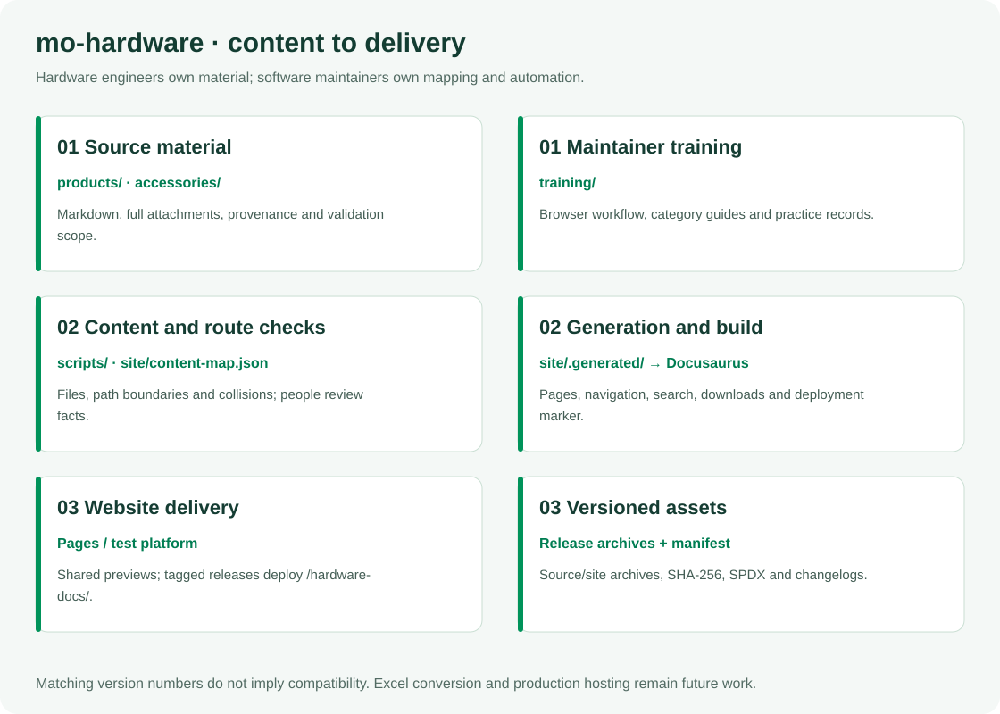

# mo-hardware

English | [简体中文](README.zh-CN.md)

Hardware references and an independently built documentation site for InHand Mo boards. Hardware engineers own product information, connectors, design files, mechanical references, revisions, validation, compliance and accessory records. Software maintainers own routing, templates, checks and release automation.

**Start with the [hardware maintainer training guide (Chinese)](training/README.zh-CN.md).** It includes a browser-first GitHub walkthrough, screenshots, a complete exercise and detailed instructions for every content category. Developers should also read [CONTRIBUTING.md](CONTRIBUTING.md); [CONTENT-CONTRACT.md](CONTENT-CONTRACT.md) defines the content and website handoff.

## Role in the Mo series


| Repository | Responsibility | Relationship to mo-hardware |
|---|---|---|
| `developer` | Portal, product navigation and release aggregation | Links to `/hardware-docs/` |
| `Mo*` | A separate BSP, image and adaptation repository for each model | Records identify the applicable board and software baseline |
| `mo-docs` | OS, software configuration and application guides | Links to hardware pages; inherited hardware URLs redirect here |
| `mo-hardware` | Hardware material, pages and validation records | Own sources, builds, previews and releases |
| `mo-tools` | Toolchain, host scripts and board test tools | Records reference exact tool versions |
| `mo-models` | Model inventory, compatibility and benchmarks | Workload records identify the model version |
| `mo-examples` | Runnable device applications | Hardware tests may reference applications; maintainer exercises stay here |

`Mo*` represents per-model BSP/image repositories without fixing their number. Repository releases, PCB revisions, assembly/BOM revisions, document revisions, template versions and software versions are separate identifiers. Matching numbers do not establish compatibility. Routine hardware releases do not rebuild mo-docs.

## Internal architecture and ownership



| Path | Hardware content | Training chapter |
|---|---|---|
| `products/<product>/overview/` | Product identity, specifications, sources and applicability | [Product](training/categories/01-product.zh-CN.md) |
| `products/<product>/images/` | Product photographs, connector views and reference captures | [Images](training/categories/02-images.zh-CN.md) |
| `products/<product>/interfaces/` | Connectors, physical pins, electrical conditions and signals | [Interfaces](training/categories/03-interfaces.zh-CN.md) |
| `products/<product>/schematics/` | Schematics, circuit explanations and source identifiers | [Schematics](training/categories/04-schematics.zh-CN.md) |
| `products/<product>/pcb/` | Approved public PCB files, stackups and manufacturing scope | [PCB](training/categories/05-pcb.zh-CN.md) |
| `products/<product>/mechanical/` | STEP models, dimensions, assembly and reference limits | [Mechanical](training/categories/06-mechanical.zh-CN.md) |
| `products/<product>/revisions/` | PCB/assembly identification and engineering changes | [Revisions](training/categories/07-revisions.zh-CN.md) |
| `products/<product>/validation/power-thermal/` | Conditions, meters, raw measurements and conclusions | [Power/thermal](training/categories/08-power-thermal.zh-CN.md) |
| `products/<product>/validation/interfaces/` | Wiring, methods, acceptance criteria and test results | [Interface tests](training/categories/09-interface-tests.zh-CN.md) |
| `products/<product>/compliance/` | Certificates, declarations, reports and applicability | [Compliance](training/categories/10-compliance.zh-CN.md) |
| `accessories/` | Shared accessory records, guides and board relationships | [Accessories](training/categories/11-accessories.zh-CN.md), [compatibility](training/categories/12-compatibility.zh-CN.md) |
| `templates/` | Reserved category templates; Excel conversion is not implemented | [Template rules](training/README.zh-CN.md#模板与语言规则) |
| `training/` | Maintainer instructions, examples and screenshots; outside product site mapping | [Web workflow](training/github-workflow.zh-CN.md) |
| `site/` | Source mapping, configuration, theme, search and generated output | [Architecture](ARCHITECTURE.md), maintained by software engineers |
| `scripts/`, `tests/`, `.github/`, `.githooks/` | Content checks, governance, tests and releases | Maintained by software engineers |

Contributors maintain ordinary `*.en-US.md` and actual attachment bytes; MDX and frontend coding are not required. The product site is English; training is Chinese. New pages and attachments require a software maintainer to update `site/content-map.json` and navigation. Uploading a file alone does not publish it on the website. Never edit `site/.generated/`, `site/.docusaurus/` or `site/build/`.

The source map retains 33 pages migrated from mo-docs `cbc6053`, plus three entry pages. Mo62A has source text, images, complete schematic PDFs and a STEP ZIP. Mo68A material directories remain reserved; inherited specifications and Coming soon pages do not constitute new validation. Excel `product.xlsx` / `record.xlsx`, field semantics and conversion remain future work. `manifest.json` is a file/source inventory; `records: []` does not claim structured hardware qualification.

## Maintenance and permissions

1. Locate the source, establish provenance, board/assembly applicability and publication scope.
2. Create a topic branch from current `master`; edit text and attachments while preserving download compatibility.
3. Open a PR to `master`, inspect the diff, `commit-message`, `ci` and the corresponding site preview.
4. Apply feedback on the same branch. An Admin squash-merges after required checks; the source branch is deleted automatically.
5. The merged build updates Pages. An Admin creates a separate annotated Tag to release the test site.

| Action | Write / hardware contributor | Admin |
|---|---|---|
| Create, update or delete topic branches; open PRs | Yes | Yes |
| Directly push or delete `master` | No | Cannot bypass PR / required CI |
| Merge a PR after successful CI | No | Yes, including their own PR; no additional review required |
| Create release tags | No | Yes |
| Rewrite or delete existing tags | No | Also prohibited by the independent immutable-tag rule |

The protection design separates master permissions from non-bypassable PR/CI requirements, and tag creation permissions from non-bypassable tag immutability: two master rules and two tag rules. Existing immutable-tag protection is retained. These four rules are active and have been read back from the repository settings; automatic source-branch deletion is enabled.

Use short English Conventional Commit titles, for example `docs(mechanical): clarify reference model usage`. Titles are limited to 72 characters; a body is optional. No bilingual `Message:` block, `Co-Authored-By` trailer or CI-skip marker is required or accepted as a workflow shortcut. Replace GitHub's generated edit title with a compliant title. Follow the [illustrated browser workflow](training/github-workflow.zh-CN.md).

## Local checks and preview

Use Node.js 22. Installation configures this clone's commit-msg/pre-push hooks:

```bash
npm ci
npm test
npm run typecheck
node scripts/check-content.mjs
npm run build
npx playwright install chromium
npm run test:site
npm run start
```

The development server defaults to `http://127.0.0.1:8042/`. Check who owns an existing preview before using its port. `npm run build` produces the complete site and search index; the development server does not produce full-text search. Checks use the Git file list, so add new files to Git before checking. The optional lightweight material index needs explicit arguments documented in [test/README.md](test/README.md); it does not replace full-site acceptance.

| Variable | Purpose |
|---|---|
| `HARDWARE_SITE_URL` | Site origin, for example `https://developer.inhand.online` |
| `HARDWARE_BASE_URL` | Leading/trailing slash path: `/hardware-docs/` for test, `/mo-hardware/` for Pages |
| `DOCUMENTATION_URL` | Matching software documentation URL |
| `DEVELOPER_PORTAL_URL` | Matching portal URL |
| `HARDWARE_PREVIEW` / `HARDWARE_PREVIEW_LABEL` | Preview banner and build identity |
| `HARDWARE_ENVIRONMENT` | Environment in `deployment.json` |

## Preview, versions and releases


PR/master CI builds and tests with read-only permissions. An independent Pages job deploys only the static artifact and never executes PR code. Pages is a shared slot that another successful build can replace. Check the banner and `deployment.json`, not just the URL. A PR merge-checkout SHA may differ from its head; compare it with the matching CI run.

All pushed tags trigger validation. Valid names are `VX.Y.Z` and `VX.Y.Z-rcN`: uppercase `V`, no leading zeros, RC count starting at one. Releases require an annotated tag on a commit in `master` history. Creating a Release in the web UI does not replace that requirement; administrators follow the CONTRIBUTING command sequence. Tag checks run in CI after push.

Release assets include versioned source/material and website archives, a source-commit/SHA-256 `manifest.json`, an SPDX SBOM, English and Chinese changelogs, combined notes and `SHA256SUMS`. The SBOM covers repository distribution, not the physical board BOM. The internal package version manages dependencies; the Tag defines the released site version.

Changelogs accumulate from the previous stable release and retain legacy English Message summaries. Chinese headings/categories are fixed translations; entries stay English.

| Platform | Translation server | Status |
|---|---|---|
| GitHub | `-` | API reserved for later integration; no translation credentials needed |
| GitLab | `-` | Shared Mo-series policy placeholder |

After Release publication, the test platform deploys under `/hardware-docs/`, verifies hashes and the live marker, and invokes the restricted rollback command on smoke-check failure. `OPS_DEPLOY_HOST`, `OPS_DEPLOY_USER`, `OPS_DEPLOY_SSH_KEY` and `OPS_DEPLOY_HOST_KEY` are required. Only test-platform deployment is currently integrated; a stable Release does not establish a production-site deployment. RCs are prereleases and do not replace the latest stable version.

## Content and license

Specifications require attributable source material; test results require conditions and original evidence. Keep unrecorded, untested, design-reference and passing-test states distinct. Training exercises are not hardware evidence. Website content contains no sale prices; purchasing links lead to the store.

Use the [contact page](https://developer.inhand.online/contact/) for product questions, Issues/PRs for documentation corrections and [SECURITY.md](SECURITY.md) for sensitive reports. Original content is licensed under [CC BY-SA 4.0](LICENSE). Third-party attachments, fonts, software and GitHub documentation screenshots retain their own licenses and notices; use official links when redistribution rights are unavailable. Content licensing does not grant patent/trademark rights or establish hardware certification.
