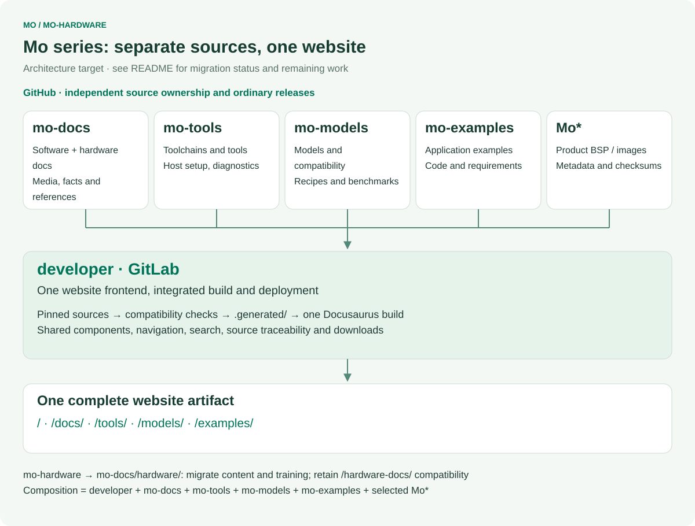
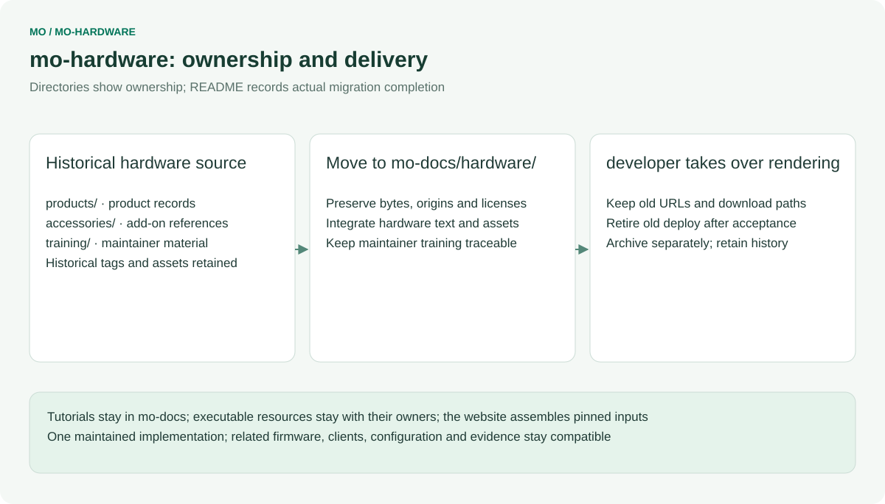
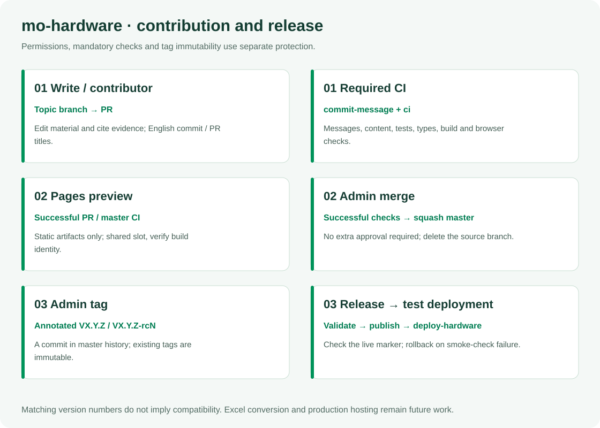

# mo-hardware

English | [简体中文](README.zh-CN.md)

Historical hardware source repository, being consolidated into mo-docs/hardware/. In the unified architecture, mo-docs owns software/hardware content and developer owns the only website frontend, build and deployment. Historical files, training, tags and releases remain available. The unified site has not been rolled out and this repository is not archived.

**Start new hardware maintenance in mo-docs `hardware/training/`.** The [training guide here (Chinese)](training/README.zh-CN.md) preserves the pre-migration workflow. It includes a browser-first GitHub walkthrough, screenshots, a complete exercise and detailed instructions for every content category. Developers should also read [CONTRIBUTING.md](CONTRIBUTING.md); [CONTENT-CONTRACT.md](CONTENT-CONTRACT.md) defines the content and website handoff.

## Role in the Mo series

[](architecture/repository-map.en.svg)

<table width="100%">
  <thead>
    <tr>
      <th width="171" align="left">Repository</th>
      <th width="398" align="left">Maintained source</th>
      <th width="379" align="left">Delivery responsibility</th>
    </tr>
  </thead>
  <tbody>
    <tr>
      <td align="left"><strong>developer</strong> · GitLab</td>
      <td align="left">Website components, routes, search, integration and contracts</td>
      <td align="left">The complete website, release composition and deployment</td>
    </tr>
    <tr>
      <td align="left"><a href="https://github.com/inhandnet/mo-docs">mo-docs</a></td>
      <td align="left">Software/hardware tutorials, specifications, media, design files and training</td>
      <td align="left">Versioned content and reference assets</td>
    </tr>
    <tr>
      <td align="left"><a href="https://github.com/inhandnet/mo-tools">mo-tools</a></td>
      <td align="left">Toolchain/SDK selection, environment setup, reusable tools and Studio</td>
      <td align="left">Tool metadata and source packages</td>
    </tr>
    <tr>
      <td align="left"><a href="https://github.com/inhandnet/mo-models">mo-models</a></td>
      <td align="left">Model catalog, compilation resources, compatibility and raw benchmarks</td>
      <td align="left">Model references, evidence and artifact status</td>
    </tr>
    <tr>
      <td align="left"><a href="https://github.com/inhandnet/mo-examples">mo-examples</a></td>
      <td align="left">Complete examples with related firmware, clients and configuration</td>
      <td align="left">Example sources and their requirements</td>
    </tr>
    <tr>
      <td align="left"><strong>Mo*</strong> · product repositories</td>
      <td align="left">Each product&#x27;s BSP, drivers, root filesystem, image build and flashing</td>
      <td align="left">Product images and checksummed release metadata</td>
    </tr>
  </tbody>
</table>

`Mo*` covers independently maintained product repositories such as [Mo62A](https://github.com/inhandnet/Mo62A), Mo68A, Mo69A, Mo67A, Mo3588 and Mo3568. The framework does not fix their number. Hardware content and maintainer training move from mo-hardware into mo-docs; mo-hardware remains a historical migration source and is not a separate member of the target website composition.

Each source repository publishes ordinary versions. Developer alone has website RC/final channels. The target composition binds **developer + mo-docs + mo-tools + mo-models + mo-examples + selected Mo\*** to exact commits and consumed-asset hashes. A new source release does not change an already frozen website combination. Tutorial applicability, PCB revisions, image versions and actual validation remain distinct.

## Historical layout and migration mapping

[](architecture/ownership.en.svg)

<table width="100%">
  <thead>
    <tr>
      <th width="246" align="left">Path</th>
      <th width="351" align="left">Hardware content</th>
      <th width="351" align="left">Training chapter</th>
    </tr>
  </thead>
  <tbody>
    <tr>
      <td align="left"><code>products/&lt;product&gt;/overview/</code></td>
      <td align="left">Product identity, specifications, sources and applicability</td>
      <td align="left"><a href="training/categories/01-product.zh-CN.md">Product</a></td>
    </tr>
    <tr>
      <td align="left"><code>products/&lt;product&gt;/images/</code></td>
      <td align="left">Product photographs, connector views and reference captures</td>
      <td align="left"><a href="training/categories/02-images.zh-CN.md">Images</a></td>
    </tr>
    <tr>
      <td align="left"><code>products/&lt;product&gt;/interfaces/</code></td>
      <td align="left">Connectors, physical pins, electrical conditions and signals</td>
      <td align="left"><a href="training/categories/03-interfaces.zh-CN.md">Interfaces</a></td>
    </tr>
    <tr>
      <td align="left"><code>products/&lt;product&gt;/schematics/</code></td>
      <td align="left">Schematics, circuit explanations and source identifiers</td>
      <td align="left"><a href="training/categories/04-schematics.zh-CN.md">Schematics</a></td>
    </tr>
    <tr>
      <td align="left"><code>products/&lt;product&gt;/pcb/</code></td>
      <td align="left">Approved public PCB files, stackups and manufacturing scope</td>
      <td align="left"><a href="training/categories/05-pcb.zh-CN.md">PCB</a></td>
    </tr>
    <tr>
      <td align="left"><code>products/&lt;product&gt;/mechanical/</code></td>
      <td align="left">STEP models, dimensions, assembly and reference limits</td>
      <td align="left"><a href="training/categories/06-mechanical.zh-CN.md">Mechanical</a></td>
    </tr>
    <tr>
      <td align="left"><code>products/&lt;product&gt;/revisions/</code></td>
      <td align="left">PCB/assembly identification and engineering changes</td>
      <td align="left"><a href="training/categories/07-revisions.zh-CN.md">Revisions</a></td>
    </tr>
    <tr>
      <td align="left"><code>products/&lt;product&gt;/validation/power-thermal/</code></td>
      <td align="left">Conditions, meters, raw measurements and conclusions</td>
      <td align="left"><a href="training/categories/08-power-thermal.zh-CN.md">Power/thermal</a></td>
    </tr>
    <tr>
      <td align="left"><code>products/&lt;product&gt;/validation/interfaces/</code></td>
      <td align="left">Wiring, methods, acceptance criteria and test results</td>
      <td align="left"><a href="training/categories/09-interface-tests.zh-CN.md">Interface tests</a></td>
    </tr>
    <tr>
      <td align="left"><code>products/&lt;product&gt;/compliance/</code></td>
      <td align="left">Certificates, declarations, reports and applicability</td>
      <td align="left"><a href="training/categories/10-compliance.zh-CN.md">Compliance</a></td>
    </tr>
    <tr>
      <td align="left"><code>accessories/</code></td>
      <td align="left">Shared accessory records, guides and board relationships</td>
      <td align="left"><a href="training/categories/11-accessories.zh-CN.md">Accessories</a>, <a href="training/categories/12-compatibility.zh-CN.md">compatibility</a></td>
    </tr>
    <tr>
      <td align="left"><code>templates/</code></td>
      <td align="left">Reserved category templates; Excel conversion is not implemented</td>
      <td align="left"><a href="training/README.zh-CN.md#%E6%A8%A1%E6%9D%BF%E4%B8%8E%E8%AF%AD%E8%A8%80%E8%A7%84%E5%88%99">Template rules</a></td>
    </tr>
    <tr>
      <td align="left"><code>training/</code></td>
      <td align="left">Maintainer instructions, examples and screenshots; outside product site mapping</td>
      <td align="left"><a href="training/github-workflow.zh-CN.md">Web workflow</a></td>
    </tr>
    <tr>
      <td align="left"><code>site/</code></td>
      <td align="left">Source mapping, configuration, theme, search and generated output</td>
      <td align="left"><a href="ARCHITECTURE.md">Architecture</a>, maintained by software engineers</td>
    </tr>
    <tr>
      <td align="left"><code>scripts/</code>, <code>tests/</code>, <code>.github/</code>, <code>.githooks/</code></td>
      <td align="left">Content checks, governance, tests and releases</td>
      <td align="left">Maintained by software engineers</td>
    </tr>
  </tbody>
</table>

Contributors maintain ordinary `*.en-US.md` and actual attachment bytes; MDX and frontend coding are not required. The product site is English; training is Chinese. New pages and attachments require a software maintainer to update `site/content-map.json` and navigation. Uploading a file alone does not publish it on the website. Never edit `site/.generated/`, `site/.docusaurus/` or `site/build/`.

The source map retains 33 pages migrated from mo-docs `cbc6053`, plus three entry pages. Mo62A has source text, images, complete schematic PDFs and a STEP ZIP. Mo68A material directories remain reserved; inherited specifications and Coming soon pages do not constitute new validation. Excel `product.xlsx` / `record.xlsx`, field semantics and conversion remain future work. `manifest.json` is a file/source inventory; `records: []` does not claim structured hardware qualification.

## Historical workflow and current permissions

The steps below describe the retained historical project. New content belongs in mo-docs and uses unified website acceptance; do not extend the old deployment with new hardware RCs.

1. Locate the source, establish provenance, board/assembly applicability and publication scope.
2. Create a topic branch from current `master`; edit text and attachments while preserving download compatibility.
3. Open a PR to `master`, inspect the diff, `commit-message`, `ci` and the corresponding site preview.
4. Apply feedback on the same branch. An Admin squash-merges after required checks; the source branch is deleted automatically.
5. The merged build updates Pages. An Admin creates a separate annotated Tag to release the test site.

<table width="100%">
  <thead>
    <tr>
      <th width="436" align="left">Action</th>
      <th width="256" align="left">Write / hardware contributor</th>
      <th width="256" align="left">Admin</th>
    </tr>
  </thead>
  <tbody>
    <tr>
      <td align="left">Create, update or delete topic branches; open PRs</td>
      <td align="left">Yes</td>
      <td align="left">Yes</td>
    </tr>
    <tr>
      <td align="left">Directly push or delete <code>master</code></td>
      <td align="left">No</td>
      <td align="left">Cannot bypass PR / required CI</td>
    </tr>
    <tr>
      <td align="left">Merge a PR after successful CI</td>
      <td align="left">No</td>
      <td align="left">Yes, including their own PR; no additional review required</td>
    </tr>
    <tr>
      <td align="left">Create release tags</td>
      <td align="left">No</td>
      <td align="left">Yes</td>
    </tr>
    <tr>
      <td align="left">Rewrite or delete existing tags</td>
      <td align="left">No</td>
      <td align="left">Also prohibited by the independent immutable-tag rule</td>
    </tr>
  </tbody>
</table>

The protection design separates master permissions from non-bypassable PR/CI requirements, and tag creation permissions from non-bypassable tag immutability: two master rules and two tag rules. Existing immutable-tag protection is retained. These four rules are active and have been read back from the repository settings; automatic source-branch deletion is enabled.

Use short English Conventional Commit titles, for example `docs(mechanical): clarify reference model usage`. Titles are limited to 72 characters; a body is optional. No bilingual `Message:` block, `Co-Authored-By` trailer or CI-skip marker is required or accepted as a workflow shortcut. Replace GitHub's generated edit title with a compliant title. Follow the [illustrated browser workflow](training/github-workflow.zh-CN.md).

## Historical project checks and preview

Use Node.js 22. Installation configures this clone's commit-msg/pre-push hooks:

```bash
npm ci
npm test
npm run typecheck
node scripts/check-content.mjs
npm run build
npx playwright install chromium
npm run test:site
npm run start
```

The development server defaults to `http://127.0.0.1:8042/`. Check who owns an existing preview before using its port. `npm run build` produces the complete site and search index; the development server does not produce full-text search. Checks use the Git file list, so add new files to Git before checking. The optional lightweight material index needs explicit arguments documented in [test/README.md](test/README.md); it does not replace full-site acceptance.

<table width="100%">
  <thead>
    <tr>
      <th width="284" align="left">Variable</th>
      <th width="664" align="left">Purpose</th>
    </tr>
  </thead>
  <tbody>
    <tr>
      <td align="left"><code>HARDWARE_SITE_URL</code></td>
      <td align="left">Site origin, for example <code>https://developer.inhand.online</code></td>
    </tr>
    <tr>
      <td align="left"><code>HARDWARE_BASE_URL</code></td>
      <td align="left">Leading/trailing slash path: <code>/hardware-docs/</code> for test, <code>/mo-hardware/</code> for Pages</td>
    </tr>
    <tr>
      <td align="left"><code>DOCUMENTATION_URL</code></td>
      <td align="left">Matching software documentation URL</td>
    </tr>
    <tr>
      <td align="left"><code>DEVELOPER_PORTAL_URL</code></td>
      <td align="left">Matching portal URL</td>
    </tr>
    <tr>
      <td align="left"><code>HARDWARE_PREVIEW</code> / <code>HARDWARE_PREVIEW_LABEL</code></td>
      <td align="left">Preview banner and build identity</td>
    </tr>
    <tr>
      <td align="left"><code>HARDWARE_ENVIRONMENT</code></td>
      <td align="left">Environment in <code>deployment.json</code></td>
    </tr>
  </tbody>
</table>

## Preview, versions and releases

[](architecture/release-flow.en.svg)

This diagram describes the unified target, not a completed retirement of the old hardware site. First verify text, attachment hashes, training and old URLs; retire old deployment only after developer full-site and rollback acceptance. Do not extend a third website release line with new hardware RCs during migration. Existing scripts, tags and releases remain for traceability and recovery; repository archival is separate.

The new maintenance flow lives in mo-docs/hardware/training/. Independent-site operations in this repository and its old training describe the pre-migration project.

## Content and license

Specifications require attributable source material; test results require conditions and original evidence. Keep unrecorded, untested, design-reference and passing-test states distinct. Training exercises are not hardware evidence. Website content contains no sale prices; purchasing links lead to the store.

Use the [contact page](https://developer.inhand.online/contact/) for product questions, Issues/PRs for documentation corrections and [SECURITY.md](SECURITY.md) for sensitive reports. Original content is licensed under [CC BY-SA 4.0](LICENSE). Third-party attachments, fonts, software and GitHub documentation screenshots retain their own licenses and notices; use official links when redistribution rights are unavailable. Content licensing does not grant patent/trademark rights or establish hardware certification.
