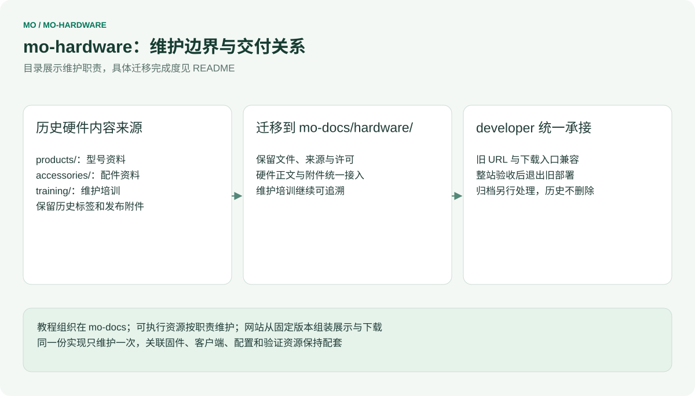

# mo-hardware

[English](README.md) | 简体中文

历史硬件资料仓库，正在迁入 mo-docs/hardware/。统一目标由 mo-docs 维护软硬件内容，由 developer 维护唯一网站前端、构建和部署。当前仓库的历史资料、培训、标签及发布物继续保留；统一站点尚未切换，不代表本仓库已归档。

**新架构的硬件维护入口为 mo-docs 的 `hardware/training/`。** 本仓库的[维护培训手册](training/README.zh-CN.md)保留迁移前流程。 手册以 GitHub 网页为主，提供逐步截图、完整练习和每一类资料的维护说明。代码贡献者另读 [CONTRIBUTING.md](CONTRIBUTING.md)，内容格式与网站交付约定见 [CONTENT-CONTRACT.md](CONTENT-CONTRACT.md)。

## 在 Mo 系列中的职责

[](architecture/repository-map.zh-CN.svg)

<table width="100%">
  <thead>
    <tr>
      <th width="171" align="left">仓库</th>
      <th width="398" align="left">人工维护的源内容</th>
      <th width="379" align="left">交付职责</th>
    </tr>
  </thead>
  <tbody>
    <tr>
      <td align="left"><strong>developer</strong> · GitLab</td>
      <td align="left">网站组件、路由、搜索、接入层与内容接口</td>
      <td align="left">完整网站、发布组成清单与部署</td>
    </tr>
    <tr>
      <td align="left"><a href="https://github.com/inhandnet/mo-docs">mo-docs</a></td>
      <td align="left">软硬件教程、规格、媒体、设计资料与维护培训</td>
      <td align="left">版本化内容与参考附件</td>
    </tr>
    <tr>
      <td align="left"><a href="https://github.com/inhandnet/mo-tools">mo-tools</a></td>
      <td align="left">工具链/SDK 选择、环境准备、通用开发工具与 Studio</td>
      <td align="left">工具元信息和源码包</td>
    </tr>
    <tr>
      <td align="left"><a href="https://github.com/inhandnet/mo-models">mo-models</a></td>
      <td align="left">模型目录、编译资源、兼容关系与原始基准</td>
      <td align="left">模型引用、验证证据与托管状态</td>
    </tr>
    <tr>
      <td align="left"><a href="https://github.com/inhandnet/mo-examples">mo-examples</a></td>
      <td align="left">完整示例及配套固件、客户端和配置</td>
      <td align="left">示例源码及适用条件</td>
    </tr>
    <tr>
      <td align="left"><strong>Mo*</strong> · 各型号仓库</td>
      <td align="left">各自 BSP、驱动、根文件系统、镜像构建与烧录</td>
      <td align="left">系统镜像及带校验值的发布元信息</td>
    </tr>
  </tbody>
</table>

`Mo*` 表示各型号独立的产品仓库，例如 [Mo62A](https://github.com/inhandnet/Mo62A)、Mo68A、Mo69A、Mo67A、Mo3588、Mo3568，框架不固定数量。mo-hardware 的资料与维护培训迁入 mo-docs；mo-hardware 保留为历史迁移来源，不再单列为目标网站发布组成项。

各源仓库独立发布普通版本，只有 developer 区分网站 RC 与正式版。目标发布组成绑定 **developer + mo-docs + mo-tools + mo-models + mo-examples + 纳入的 Mo\***，记录准确提交与所消费附件哈希。上游新发版本不会改变已冻结的网站组合。教程适用范围、PCB 修订、镜像版本和实际验证结论分别记录。

## 历史目录与迁移对应关系

[](architecture/ownership.zh-CN.svg)

<table width="100%">
  <thead>
    <tr>
      <th width="246" align="left">目录</th>
      <th width="351" align="left">硬件工程师维护什么</th>
      <th width="351" align="left">逐项说明</th>
    </tr>
  </thead>
  <tbody>
    <tr>
      <td align="left"><code>products/&lt;product&gt;/overview/</code></td>
      <td align="left">产品身份、规格、来源和适用范围</td>
      <td align="left"><a href="training/categories/01-product.zh-CN.md">产品信息</a></td>
    </tr>
    <tr>
      <td align="left"><code>products/&lt;product&gt;/images/</code></td>
      <td align="left">产品图、接口定位图和资料截图</td>
      <td align="left"><a href="training/categories/02-images.zh-CN.md">图片</a></td>
    </tr>
    <tr>
      <td align="left"><code>products/&lt;product&gt;/interfaces/</code></td>
      <td align="left">连接器、物理引脚、电气条件与信号定义</td>
      <td align="left"><a href="training/categories/03-interfaces.zh-CN.md">接口</a></td>
    </tr>
    <tr>
      <td align="left"><code>products/&lt;product&gt;/schematics/</code></td>
      <td align="left">原理图、模块说明、文件标识和来源</td>
      <td align="left"><a href="training/categories/04-schematics.zh-CN.md">原理图</a></td>
    </tr>
    <tr>
      <td align="left"><code>products/&lt;product&gt;/pcb/</code></td>
      <td align="left">获准公开的 PCB 资料、叠层和制造边界</td>
      <td align="left"><a href="training/categories/05-pcb.zh-CN.md">PCB</a></td>
    </tr>
    <tr>
      <td align="left"><code>products/&lt;product&gt;/mechanical/</code></td>
      <td align="left">STEP、尺寸、装配与参考用途</td>
      <td align="left"><a href="training/categories/06-mechanical.zh-CN.md">机械</a></td>
    </tr>
    <tr>
      <td align="left"><code>products/&lt;product&gt;/revisions/</code></td>
      <td align="left">PCB/装配标识、正式变更与适用文件</td>
      <td align="left"><a href="training/categories/07-revisions.zh-CN.md">硬件版本</a></td>
    </tr>
    <tr>
      <td align="left"><code>products/&lt;product&gt;/validation/power-thermal/</code></td>
      <td align="left">条件、仪器、功耗/温度原始数据与结论</td>
      <td align="left"><a href="training/categories/08-power-thermal.zh-CN.md">功耗温度</a></td>
    </tr>
    <tr>
      <td align="left"><code>products/&lt;product&gt;/validation/interfaces/</code></td>
      <td align="left">接线、方法、判定标准与接口测试结果</td>
      <td align="left"><a href="training/categories/09-interface-tests.zh-CN.md">接口测试</a></td>
    </tr>
    <tr>
      <td align="left"><code>products/&lt;product&gt;/compliance/</code></td>
      <td align="left">证书、声明、报告、有效范围与安装要求</td>
      <td align="left"><a href="training/categories/10-compliance.zh-CN.md">合规</a></td>
    </tr>
    <tr>
      <td align="left"><code>accessories/</code></td>
      <td align="left">配件共用记录、指南和板卡兼容关系</td>
      <td align="left"><a href="training/categories/11-accessories.zh-CN.md">配件</a>、<a href="training/categories/12-compatibility.zh-CN.md">兼容关系</a></td>
    </tr>
    <tr>
      <td align="left"><code>templates/</code></td>
      <td align="left">分类模板预留目录；Excel 方案尚未实现</td>
      <td align="left"><a href="training/README.zh-CN.md#%E6%A8%A1%E6%9D%BF%E4%B8%8E%E8%AF%AD%E8%A8%80%E8%A7%84%E5%88%99">模板与语言规则</a></td>
    </tr>
    <tr>
      <td align="left"><code>training/</code></td>
      <td align="left">维护培训、示例、截图；不进入产品站资料映射</td>
      <td align="left"><a href="training/github-workflow.zh-CN.md">完整操作流程</a></td>
    </tr>
    <tr>
      <td align="left"><code>site/</code></td>
      <td align="left">映射、站点配置、主题、搜索和构建输出</td>
      <td align="left">软件维护者负责，详见 <a href="ARCHITECTURE.md">ARCHITECTURE.md</a></td>
    </tr>
    <tr>
      <td align="left"><code>scripts/</code>、<code>tests/</code>、<code>.github/</code>、<code>.githooks/</code></td>
      <td align="left">内容检查、治理、测试与发布</td>
      <td align="left">软件维护者负责</td>
    </tr>
  </tbody>
</table>

日常修改使用普通 `*.en-US.md` 和真实附件，不要求硬件工程师维护 MDX 或前端代码。网站当前为英文；培训手册为中文。新增页面、图片或附件必须由软件维护者检查 `site/content-map.json` 的映射及导航，上传文件本身不等于网站已展示。`site/.generated/`、`site/.docusaurus/`、`site/build/` 为生成目录，不手工编辑。

本仓库保留从 mo-docs `cbc6053` 迁入的 33 条页面映射和 3 个入口。Mo62A 已有正文、图片、完整原理图 PDF 与 STEP ZIP；Mo68A 资料目录为预留，继承网页中的规格或 Coming soon 不代表新验证。Excel 的 `product.xlsx` / `record.xlsx`、字段校验和自动转换仍是后续设计；目前 `manifest.json` 是文件与来源清单，`records: []` 不代表结构化硬件验证已完成。

## 历史维护流程与现有权限

以下步骤描述保留的历史工程。新内容在 mo-docs 中提交，按统一网站集成流程验收；不再通过新增硬件 RC 延续旧部署。

1. 找到本次资料的源文件，核对来源、板卡/装配版本和公开范围。
2. 从最新 `master` 创建主题分支，修改正文与附件；保留旧下载兼容性和事实边界。
3. 向 `master` 提 PR，查看差异、`commit-message` 和 `ci`，核对该提交的站点预览。
4. 处理反馈并继续提交到同一分支；检查成功后，由 Admin squash 合并。合并自动删除源分支。
5. 合并更新 Pages 工程预览；发布测试平台需要 Admin 另建 annotated Tag。

<table width="100%">
  <thead>
    <tr>
      <th width="436" align="left">操作</th>
      <th width="256" align="left">Write / 硬件贡献者</th>
      <th width="256" align="left">Admin</th>
    </tr>
  </thead>
  <tbody>
    <tr>
      <td align="left">创建、修改、删除临时分支；提 PR</td>
      <td align="left">可以</td>
      <td align="left">可以</td>
    </tr>
    <tr>
      <td align="left">直接推送或删除 <code>master</code></td>
      <td align="left">不允许</td>
      <td align="left">不允许绕过 PR / 必需 CI</td>
    </tr>
    <tr>
      <td align="left">CI 成功后合并 PR</td>
      <td align="left">不可以</td>
      <td align="left">可以；自己的 PR 也可自行合并，不强制额外审批</td>
    </tr>
    <tr>
      <td align="left">创建发布 Tag</td>
      <td align="left">不可以</td>
      <td align="left">可以</td>
    </tr>
    <tr>
      <td align="left">改写或删除现有 Tag</td>
      <td align="left">不允许</td>
      <td align="left">独立不可变规则同样禁止</td>
    </tr>
  </tbody>
</table>

保护设计为两条 master 规则与两条 Tag 规则：主线操作权限与无 bypass 的 PR/CI 检查分开；Tag 创建权限与无 bypass 的不可变性分开。保留已有 Tag 不可变保护。这四条规则已在远端实施并回读；合并后自动删除源分支已开启。

提交和 PR 标题使用简短英文 Conventional Commit，如 `docs(mechanical): clarify reference model usage`。标题最多 72 字符，正文可选；不要求双语 `Message:` 块，不加 `Co-Authored-By`，不使用跳过 CI 的标记。GitHub 网页的默认提交标题需要改成此格式。完整步骤与截图见[网页维护流程](training/github-workflow.zh-CN.md)。

## 历史工程检查与预览

使用 Node.js 22，安装时自动启用本仓库 commit-msg/pre-push 钩子：

```bash
npm ci
npm test
npm run typecheck
node scripts/check-content.mjs
npm run build
npx playwright install chromium
npm run test:site
npm run start
```

本地开发默认 `http://127.0.0.1:8042/`。若已有预览服务，先确认其归属，不占用或停止其他任务端口。`npm run build` 构建完整站点；`npm run start` 的开发服务器不生成完整搜索索引。检查读取 Git 文件清单，新增文件需先纳入 Git。`npm run preview:build` 的旧轻量资料索引通过显式参数运行，见 [test/README.md](test/README.md)，不替代完整站点验收。

<table width="100%">
  <thead>
    <tr>
      <th width="284" align="left">变量</th>
      <th width="664" align="left">用途</th>
    </tr>
  </thead>
  <tbody>
    <tr>
      <td align="left"><code>HARDWARE_SITE_URL</code></td>
      <td align="left">本站 origin，例如 <code>https://developer.inhand.online</code></td>
    </tr>
    <tr>
      <td align="left"><code>HARDWARE_BASE_URL</code></td>
      <td align="left">带前后斜杠的路径；测试站 <code>/hardware-docs/</code>，Pages <code>/mo-hardware/</code></td>
    </tr>
    <tr>
      <td align="left"><code>DOCUMENTATION_URL</code></td>
      <td align="left">与当前环境匹配的软件文档入口</td>
    </tr>
    <tr>
      <td align="left"><code>DEVELOPER_PORTAL_URL</code></td>
      <td align="left">与当前环境匹配的开发者主站入口</td>
    </tr>
    <tr>
      <td align="left"><code>HARDWARE_PREVIEW</code> / <code>HARDWARE_PREVIEW_LABEL</code></td>
      <td align="left">工程预览提示与构建标识</td>
    </tr>
    <tr>
      <td align="left"><code>HARDWARE_ENVIRONMENT</code></td>
      <td align="left">在线 <code>deployment.json</code> 的环境标识</td>
    </tr>
  </tbody>
</table>

## 预览、版本与发布

[](architecture/release-flow.zh-CN.svg)

此图描述统一网站目标，不表示旧硬件站已经退出。迁移先核验正文、附件哈希、培训与旧 URL；developer 完整站点及回滚验收后，才能停止旧站部署。迁移不通过新硬件 RC 继续建立第三套网站发布线。现有脚本、历史 Tag 和 Release 保留用于追溯与恢复；仓库归档另行处理。

新内容维护流程位于 mo-docs/hardware/training/；本仓库下文和旧培训中的独立站操作属于迁移前历史工程。

## 内容与许可

规格来自可追溯的产品/设计材料，测试结果带条件和原始证据；未记录、未测试、设计参考和测试通过分别表达。训练示例不作为硬件验证。网页不出现销售价格，购买入口指向商城。

产品问题见[联系页面](https://developer.inhand.online/contact/)，资料纠错用 Issue / PR，敏感报告遵循 [SECURITY.md](SECURITY.md)。原始文档与资料默认使用 [CC BY-SA 4.0](LICENSE)；第三方附件、字体、软件和 GitHub 官方截图保留各自许可与来源，没有再分发权时只给官方链接。内容许可不授予专利、商标权，也不建立硬件认证。
