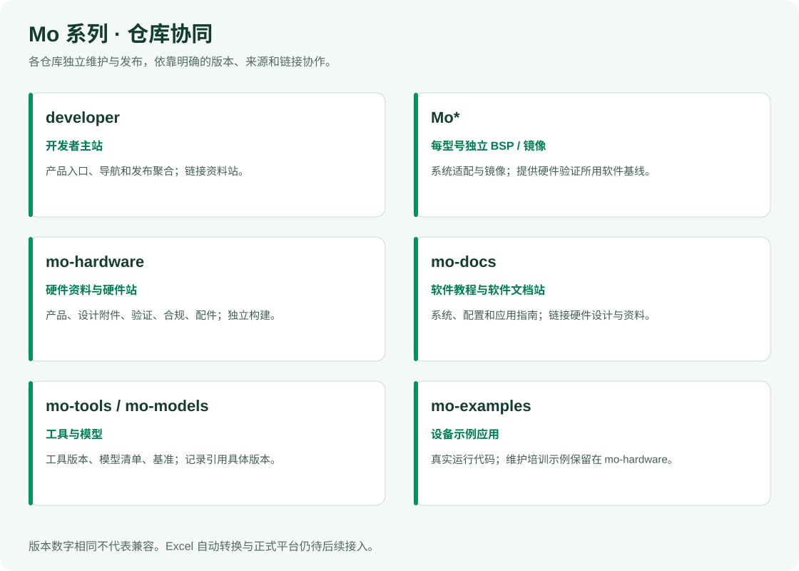
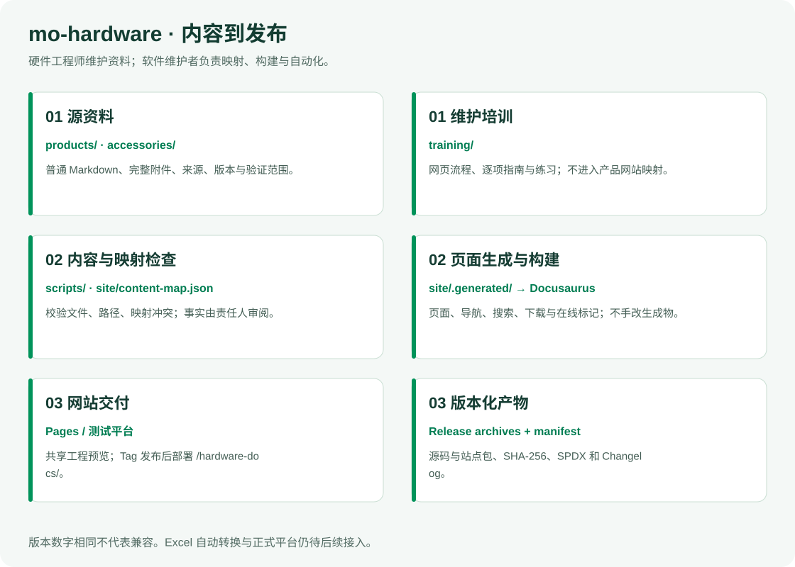
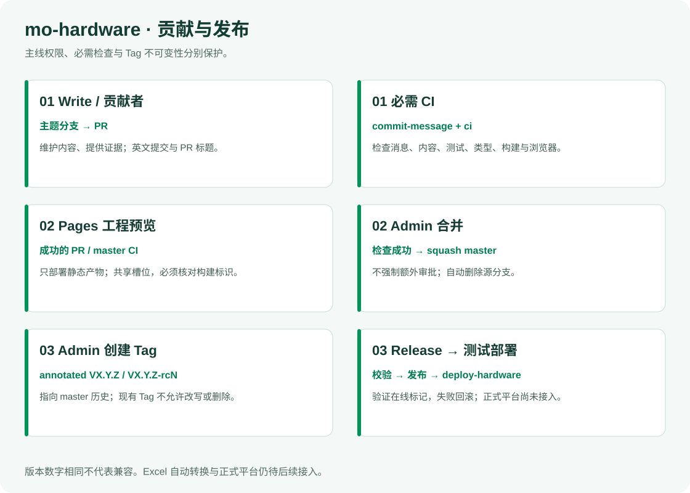

# mo-hardware

[English](README.md) | 简体中文

InHand Mo 系列的硬件资料与独立硬件文档站。硬件工程师维护产品、接口、设计文件、机械资料、版本、验证记录、合规与配件内容；软件维护者负责页面映射、主题、构建和发布自动化。

**硬件工程师从[维护培训手册](training/README.zh-CN.md)开始。** 手册以 GitHub 网页为主，提供逐步截图、完整练习和每一类资料的维护说明。代码贡献者另读 [CONTRIBUTING.md](CONTRIBUTING.md)，内容格式与网站交付约定见 [CONTENT-CONTRACT.md](CONTENT-CONTRACT.md)。

## 在 Mo 系列中的职责



| 仓库 | 维护内容 | 与 mo-hardware 的关系 |
|---|---|---|
| `developer` | 产品入口、开发者导航和版本聚合 | 链接独立硬件站 `/hardware-docs/` |
| `Mo*` | 每型号独立的 BSP、镜像与系统适配 | 硬件资料注明对应板卡/版本；软件配置链接到软件指南 |
| `mo-docs` | OS、软件配置、应用开发和教程 | 链接硬件页，旧硬件 URL 跳转到本仓库站点 |
| `mo-hardware` | 硬件参考文件、资料页面与测试记录 | 自己维护来源、构建、预览和 Release |
| `mo-tools` | 工具链、主机脚本与板测工具 | 验证记录引用具体工具版本，不复制工具代码 |
| `mo-models` | 模型清单、兼容信息和模型基准 | 功耗/温度等记录注明用到的模型版本 |
| `mo-examples` | 可运行的示例应用 | 硬件验证可引用示例，但不混入本站维护培训样例 |

`Mo*` 表示各型号独立的 BSP/镜像仓库，不限定型号或仓库数量。仓库发布版本、PCB 版本、装配/BOM 版本、资料修订版、模板版和软件版本分别记录；数字相同不表示已验证兼容。日常硬件站发布不要求重新构建 mo-docs。

## 内部架构与内容入口



| 目录 | 硬件工程师维护什么 | 逐项说明 |
|---|---|---|
| `products/<product>/overview/` | 产品身份、规格、来源和适用范围 | [产品信息](training/categories/01-product.zh-CN.md) |
| `products/<product>/images/` | 产品图、接口定位图和资料截图 | [图片](training/categories/02-images.zh-CN.md) |
| `products/<product>/interfaces/` | 连接器、物理引脚、电气条件与信号定义 | [接口](training/categories/03-interfaces.zh-CN.md) |
| `products/<product>/schematics/` | 原理图、模块说明、文件标识和来源 | [原理图](training/categories/04-schematics.zh-CN.md) |
| `products/<product>/pcb/` | 获准公开的 PCB 资料、叠层和制造边界 | [PCB](training/categories/05-pcb.zh-CN.md) |
| `products/<product>/mechanical/` | STEP、尺寸、装配与参考用途 | [机械](training/categories/06-mechanical.zh-CN.md) |
| `products/<product>/revisions/` | PCB/装配标识、正式变更与适用文件 | [硬件版本](training/categories/07-revisions.zh-CN.md) |
| `products/<product>/validation/power-thermal/` | 条件、仪器、功耗/温度原始数据与结论 | [功耗温度](training/categories/08-power-thermal.zh-CN.md) |
| `products/<product>/validation/interfaces/` | 接线、方法、判定标准与接口测试结果 | [接口测试](training/categories/09-interface-tests.zh-CN.md) |
| `products/<product>/compliance/` | 证书、声明、报告、有效范围与安装要求 | [合规](training/categories/10-compliance.zh-CN.md) |
| `accessories/` | 配件共用记录、指南和板卡兼容关系 | [配件](training/categories/11-accessories.zh-CN.md)、[兼容关系](training/categories/12-compatibility.zh-CN.md) |
| `templates/` | 分类模板预留目录；Excel 方案尚未实现 | [模板与语言规则](training/README.zh-CN.md#模板与语言规则) |
| `training/` | 维护培训、示例、截图；不进入产品站资料映射 | [完整操作流程](training/github-workflow.zh-CN.md) |
| `site/` | 映射、站点配置、主题、搜索和构建输出 | 软件维护者负责，详见 [ARCHITECTURE.md](ARCHITECTURE.md) |
| `scripts/`、`tests/`、`.github/`、`.githooks/` | 内容检查、治理、测试与发布 | 软件维护者负责 |

日常修改使用普通 `*.en-US.md` 和真实附件，不要求硬件工程师维护 MDX 或前端代码。网站当前为英文；培训手册为中文。新增页面、图片或附件必须由软件维护者检查 `site/content-map.json` 的映射及导航，上传文件本身不等于网站已展示。`site/.generated/`、`site/.docusaurus/`、`site/build/` 为生成目录，不手工编辑。

本仓库保留从 mo-docs `cbc6053` 迁入的 33 条页面映射和 3 个入口。Mo62A 已有正文、图片、完整原理图 PDF 与 STEP ZIP；Mo68A 资料目录为预留，继承网页中的规格或 Coming soon 不代表新验证。Excel 的 `product.xlsx` / `record.xlsx`、字段校验和自动转换仍是后续设计；目前 `manifest.json` 是文件与来源清单，`records: []` 不代表结构化硬件验证已完成。

## 维护流程与权限

1. 找到本次资料的源文件，核对来源、板卡/装配版本和公开范围。
2. 从最新 `master` 创建主题分支，修改正文与附件；保留旧下载兼容性和事实边界。
3. 向 `master` 提 PR，查看差异、`commit-message` 和 `ci`，核对该提交的站点预览。
4. 处理反馈并继续提交到同一分支；检查成功后，由 Admin squash 合并。合并自动删除源分支。
5. 合并更新 Pages 工程预览；发布测试平台需要 Admin 另建 annotated Tag。

| 操作 | Write / 硬件贡献者 | Admin |
|---|---|---|
| 创建、修改、删除临时分支；提 PR | 可以 | 可以 |
| 直接推送或删除 `master` | 不允许 | 不允许绕过 PR / 必需 CI |
| CI 成功后合并 PR | 不可以 | 可以；自己的 PR 也可自行合并，不强制额外审批 |
| 创建发布 Tag | 不可以 | 可以 |
| 改写或删除现有 Tag | 不允许 | 独立不可变规则同样禁止 |

保护设计为两条 master 规则与两条 Tag 规则：主线操作权限与无 bypass 的 PR/CI 检查分开；Tag 创建权限与无 bypass 的不可变性分开。保留已有 Tag 不可变保护。这四条规则已在远端实施并回读；合并后自动删除源分支已开启。

提交和 PR 标题使用简短英文 Conventional Commit，如 `docs(mechanical): clarify reference model usage`。标题最多 72 字符，正文可选；不要求双语 `Message:` 块，不加 `Co-Authored-By`，不使用跳过 CI 的标记。GitHub 网页的默认提交标题需要改成此格式。完整步骤与截图见[网页维护流程](training/github-workflow.zh-CN.md)。

## 本地检查与预览

使用 Node.js 22，安装时自动启用本仓库 commit-msg/pre-push 钩子：

```bash
npm ci
npm test
npm run typecheck
node scripts/check-content.mjs
npm run build
npx playwright install chromium
npm run test:site
npm run start
```

本地开发默认 `http://127.0.0.1:8042/`。若已有预览服务，先确认其归属，不占用或停止其他任务端口。`npm run build` 构建完整站点；`npm run start` 的开发服务器不生成完整搜索索引。检查读取 Git 文件清单，新增文件需先纳入 Git。`npm run preview:build` 的旧轻量资料索引通过显式参数运行，见 [test/README.md](test/README.md)，不替代完整站点验收。

| 变量 | 用途 |
|---|---|
| `HARDWARE_SITE_URL` | 本站 origin，例如 `https://developer.inhand.online` |
| `HARDWARE_BASE_URL` | 带前后斜杠的路径；测试站 `/hardware-docs/`，Pages `/mo-hardware/` |
| `DOCUMENTATION_URL` | 与当前环境匹配的软件文档入口 |
| `DEVELOPER_PORTAL_URL` | 与当前环境匹配的开发者主站入口 |
| `HARDWARE_PREVIEW` / `HARDWARE_PREVIEW_LABEL` | 工程预览提示与构建标识 |
| `HARDWARE_ENVIRONMENT` | 在线 `deployment.json` 的环境标识 |

## 预览、版本与发布



PR / master CI 以只读权限构建并测试完整网站，再交给独立 Pages 工作流部署静态产物。部署工作不执行 PR 代码。Pages 是单个共享预览位置，其他成功构建可能覆盖它；根据横幅和 `deployment.json` 的提交标识确认内容，不只看网址。PR 合并前的 merge SHA 可与 PR head 不同，需和对应 CI run 核对。

所有 Tag 都触发校验；合法格式为 `VX.Y.Z` 或 `VX.Y.Z-rcN`，大写 `V`、不带前导零、`N` 从 1 开始。发布要求 annotated Tag 指向 `master` 历史中的提交。网页“创建 Release”不能代替 annotated Tag；管理员按 CONTRIBUTING 的命令流程操作。Tag 校验在推送后由 CI 执行。

Release 提供版本化源码/资料归档、静态网站包、含源提交和 SHA-256 的 `manifest.json`、仓库分发用 SPDX SBOM、两份 Changelog、组合发布说明和 `SHA256SUMS`。SBOM 描述软件/资料发布物，不是物理板卡 BOM。仓库内部 package 版本用于依赖管理，网站版本来自 Tag。

Changelog 从上一个正式版累积；历史英文 Message 摘要仍能读取。中文文件目前仅翻译固定标题与分类，条目保留英文。

| 平台 | 翻译服务器 | 状态 |
|---|---|---|
| GitHub | `-` | API 待后续接入，无需配置翻译凭据 |
| GitLab | `-` | Mo 系列统一策略占位 |

Release 成功后部署测试平台 `/hardware-docs/`，校验归档和在线标记；失败按已有受限命令回滚。依赖 `OPS_DEPLOY_HOST`、`OPS_DEPLOY_USER`、`OPS_DEPLOY_SSH_KEY`、`OPS_DEPLOY_HOST_KEY`，缺配置失败。当前自动部署只有测试平台；正式平台尚未接入，不能将正式 Tag 的 Release 当作正式网站已上线。RC 标记为 prerelease，不覆盖 latest 正式版。

## 内容与许可

规格来自可追溯的产品/设计材料，测试结果带条件和原始证据；未记录、未测试、设计参考和测试通过分别表达。训练示例不作为硬件验证。网页不出现销售价格，购买入口指向商城。

产品问题见[联系页面](https://developer.inhand.online/contact/)，资料纠错用 Issue / PR，敏感报告遵循 [SECURITY.md](SECURITY.md)。原始文档与资料默认使用 [CC BY-SA 4.0](LICENSE)；第三方附件、字体、软件和 GitHub 官方截图保留各自许可与来源，没有再分发权时只给官方链接。内容许可不授予专利、商标权，也不建立硬件认证。
