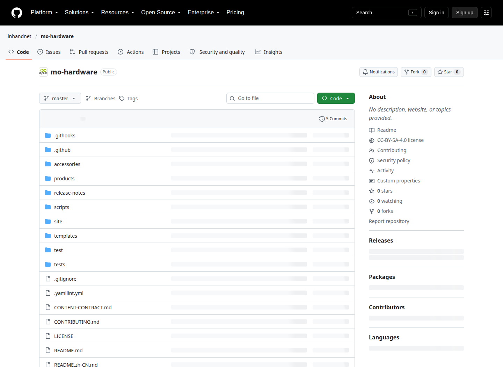

# 硬件工程师维护培训手册

本手册面向维护 Mo 系列硬件资料的工程师。主流程只需要浏览器和 GitHub 账号；你不需要编写网页、安装 Node.js 或运行命令行。完成培训后，应能找到资料的唯一源文件，说明它适用于哪块板卡，修改正文与附件，提交可审阅的 PR，并确认预览与发布的区别。

从[网页操作全流程](github-workflow.zh-CN.md)开始，再完成[机械资料练习](examples/mechanical-review/README.zh-CN.md)。日常维护时，按下表进入对应章节。培训材料保存在 `training/`，不会自动进入面向客户的硬件站。

## 一、先理解四个位置

| 位置 | 你在这里做什么 | 不能据此判断什么 |
|---|---|---|
| GitHub 源文件 | 找目录、改文字、上传附件、保存到工作分支 | 保存成功不等于合入 master 或网站已更新 |
| Pull request（PR） | 说明改动、看差异、接收反馈、查看自动检查 | CI 成功不等于硬件事实已经被验证 |
| GitHub Pages 工程预览 | 看完整页面、图片、表格、下载与导航 | 单个共享预览可能被别人覆盖；它不是发布平台 |
| 测试平台和 Release | 查看管理员发布的版本和归档 | master 合并不会自动生成新 Tag；正式平台尚未接入 |

图：本仓库公开页面实拍，截图基于 `ac48228`；后续新增的 `training/` 与架构文件应以当前仓库为准。它只展示入口，不是本轮改动已合并的证据。

## 二、每一项维护内容

下列章节都说明：当前真实位置、维护字段、填写示例、网页操作、附件与网站映射、检查方法、常见错误、协作边界。即使目前只有空目录，也会说明如何准备第一份资料以及何时交给软件维护者接入页面。

| 序号 | 内容 | 典型任务 | 章节 |
|---|---|---|---|
| 01 | 产品身份与规格 | 修正规格、补充适用范围和来源 | [产品信息](categories/01-product.zh-CN.md) |
| 02 | 图片与截图 | 更新产品图、增加接口定位说明 | [图片](categories/02-images.zh-CN.md) |
| 03 | 连接器与接口 | 核对针脚、电压、方向和复用关系 | [接口](categories/03-interfaces.zh-CN.md) |
| 04 | 原理图 | 增加获准公开的 PDF、说明模块和版本 | [原理图](categories/04-schematics.zh-CN.md) |
| 05 | PCB 资料 | 准备可公开的叠层、布局或制造参考 | [PCB](categories/05-pcb.zh-CN.md) |
| 06 | 机械与结构 | 更新 STEP、尺寸图、用途和误差边界 | [机械](categories/06-mechanical.zh-CN.md) |
| 07 | 硬件版本 | 记录 PCB、装配/BOM 与变更对应关系 | [版本](categories/07-revisions.zh-CN.md) |
| 08 | 功耗与温度 | 发布可复查的测量条件、数据和结论 | [功耗温度测试](categories/08-power-thermal.zh-CN.md) |
| 09 | 接口验证 | 记录接线、仪器、方法、判定与异常 | [接口测试](categories/09-interface-tests.zh-CN.md) |
| 10 | 合规资料 | 维护证书、声明、报告及适用范围 | [合规](categories/10-compliance.zh-CN.md) |
| 11 | 共用配件 | 编写配件身份、安装、使用和来源 | [配件](categories/11-accessories.zh-CN.md) |
| 12 | 配件兼容关系 | 说明某配件在哪种板卡/软件条件下验证 | [兼容关系](categories/12-compatibility.zh-CN.md) |

## 三、角色与工作交接

| 角色 | 负责完成 | 交付给谁 |
|---|---|---|
| 硬件贡献者（Write） | 正文、附件、来源、版本、测试范围；工作分支和 PR | 软件维护者及 Admin |
| 软件维护者 | 页面/附件映射、导航、格式和构建故障；需要时计算文件哈希 | PR 审阅者与 Admin |
| Admin | 在必需 CI 成功后合并；创建 annotated Tag；跟踪发布和部署 | 提交者及使用资料的人 |
| 事实确认人 | 对设计、测试或合规结论提供相应证据 | 硬件贡献者；这个责任不是 CI 能代替的 |

账号有 Write 权限时可创建、修改和删除临时分支；没有 Write 时按流程中的 Fork 路线。master 必须走 PR，`commit-message` 与 `ci` 必须成功。Admin 可以合并自己的 PR，不强制额外审批；事实审阅仍按资料实际内容安排。硬件贡献者不操作仓库规则、部署密钥和 Tag。

## 四、文件命名、语言和链接

- 文件/目录使用小写英文、数字与短横线，例如 `connector-review-2026-10-23`。产品既有目录是 `mo62a`，网址是 `mo-62a`，不要互换。
- 已有页面继续使用原路径和 `*.en-US.md` 文件名。当前网站是英文；PR 的说明可以写中文，提交标题和 PR 标题使用简短英文。
- 没有依据的信息写 `not recorded`（没有记录）、`not tested`（没有测试）或 `not established`（没有建立对应关系），并解释缺少什么。不能填 `0` 代替缺失值。
- 资料版本、硬件版本、软件版本分别写。原理图文件名、标题栏和 PCB 丝印不一致时逐项保留原文，不自行统一。
- 页面中的 `/img/...`、`/downloads/...` 是网站路径。GitHub 的 Preview 可能不能显示它们；完整站点预览才是图片和下载验收位置。
- 图片或附件上传后，还需检查网站映射。新页面也需映射和导航；软件维护者负责 `site/content-map.json`，硬件工程师提供“源文件 → 希望放在哪一页/哪里链接”的说明。
- 图片用 ``；链接用 `[用户看得懂的文字](/downloads/...)`。目标 URL 应由现有映射或维护者确认，不能凭文件夹名猜。

## 模板与语言规则

`templates/` 中的分类目录目前只是预留位置。`product.xlsx`、`record.xlsx` 及其自动转换、字段级校验尚未实现；不要自行建立 Excel 表并期待网站自动生成页面，也不要把 `.xlsm` 宏工作簿上传。

当前培训使用 Markdown 示例和普通附件。各章节的“字段表”是人工填写和审阅要求，不是已经上线的数据库 schema；样例中的 `EXAMPLE`、`not recorded` 不能作为真实产品数据直接发布。现有网站只读取映射中的英文正文；增加中文产品页需要软件维护者另行接入语言与路由。

## 五、培训完成标准

1. 能指出自己的资料源文件和目标网页，区分仓库路径与网站 URL。
2. 能从 master 建工作分支，用合规英文标题保存修改。
3. 能说明每个新增事实的来源、适用版本和未验证部分。
4. 能检查 Files changed，看到必需 CI 成功，核对预览构建身份。
5. 能在同一分支修订，知道谁负责合并、谁负责发布。
6. 完成练习的正文、附件和 PR 说明；培训 PR 标为 Draft 并写明不要作为产品变更合并。

讲师逐条核对[练习验收表](examples/mechanical-review/README.zh-CN.md#讲师验收)。未完成的操作据实记录，不能因示例图片显示绿色检查就写成自己的 PR 已通过。

## 六、截图来源

本仓库截图来自公开页面，只读采集；分支、编辑、上传和 PR 操作图引自 GitHub 官方文档，保留官方示例中的仓库名与分支名。图下文字会提示在 mo-hardware 中应填写的实际值。示例渲染图只表示训练文件的效果，不是在线发布记录。

截图来源、日期、许可和哈希见 [images/SOURCES.md](images/SOURCES.md)。GitHub 官方图采用其 CC BY 4.0 内容许可；不冒称这些图中的账号、PR 或操作属于本仓库。
