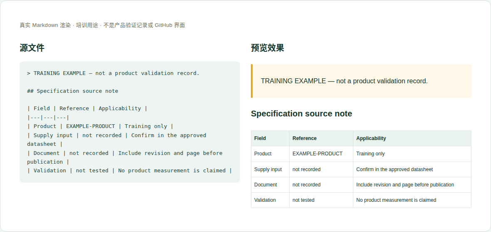

# 01 · 产品身份与规格

[培训首页](../README.zh-CN.md) · [网页操作步骤](../github-workflow.zh-CN.md)

## 维护目标与当前位置

让读者知道这是什么产品、有哪些有来源的规格，以及哪些是设计能力、哪些有实际验证。

**实际源位置：** `products/mo62a/overview/overview.en-US.md`

**当前状态：** 当前已有规格正文；产品身份、规格和来源由普通 Markdown 维护，product.xlsx 尚未启用。

本章处理资料事实与内容。所有修改都在主题分支中完成，PR/预览/合并步骤见[网页全流程](../github-workflow.zh-CN.md)。

## 每次需要填写或核对的字段

| 字段 | 填写方法与判断依据 |
|---|---|
| 产品型号 | 与产品资料原文一致，例如 Mo62A；不要把网站路由 mo-62a 当型号。 |
| 规格项与数值 | 逐项填写处理器、内存、接口、供电、尺寸等；只改本次有依据的项。 |
| 单位和限定词 | GHz、GB、V、A、mm 等不可省略；up to、nominal、maximum rating 不可随意删掉。 |
| 硬件适用范围 | PCB/装配版本、订购选项；不清楚时写 not established。 |
| 来源与位置 | 资料名称、修订版、页码/章节、公开 URL 或仓库内文件。 |
| 能力/验证分类 | 设计/产品规格与测试结果分栏，2 TOPS 不可直接写成应用 FPS。 |
| 软件关联 | OS、镜像、内核等只写适用基线，详细软件操作链接 mo-docs。 |
| 未确认项 | 销售 SKU、默认内存、产品最大值等未确认的内容不凭经验补全。 |

这些字段是人工维护要求，不是已实现的Excel自动校验。填写“未记录/未测试”时同时说明缺少什么证据；不要把缺失字段改成0或默认通过。

## 网页上如何修改这一类资料

1. 打开 overview.en-US.md，找到要更新的规格表行，逐字比对来源。
2. 只修改有证据的数值、单位或限定词；在 Sources/说明段补版本与页码。
3. 若新旧资料冲突，保留两个标识并解释差异，请产品/硬件负责人确认，不自行取较新数字。
4. 检查同一页的正文、表格、图片说明是否一致；向维护者指出 developer/mo-docs 可能需要同步的项。

完成后按统一流程保存英文提交标题，例如 `docs(hardware): update the reference details`。PR写明准确文件、来源、版本、实际检查和未完成项；新增页面/附件时明确请求映射处理。

## 可照着理解的填写示例

以下为教学样例。含 `EXAMPLE` / `not recorded` 的字段不是产品结论，须用已确认资料替换才可用于真实记录。引用已有公开记录的说明不代表本轮重做了硬件测试。

```markdown
## Specification source note

| Field | Reference | Applicability |
|---|---|---|
| Product | EXAMPLE-PRODUCT | Training only |
| Supply input | not recorded | Confirm in the approved datasheet |
| Document | not recorded | Include revision and page before publication |
| Validation | not tested | No product measurement is claimed |
```



图：上述文本的本地实际渲染，帮助识别填写后的层次和表格。它不是GitHub操作截图，也不是产品站或测试验收截图。

## 附件和网站接入

产品 datasheet 优先链接官方稳定来源。需要仓库存副本时确认公开/再分发范围并提供来源说明，由维护者登记下载映射。产品图片走下一章，不把截图当结构化规格的唯一来源。

新增源文件在GitHub可见后，请维护者确认网站映射、页面引用和导航。当前构建不会自动扫描所有资料目录生成页面。你不需要编辑 `site/` 或生成目录；交接时提供目标页面和摆放位置即可。

## 提交前逐项检查

- [ ] 数值、单位、上下限与来源一致。
- [ ] 订购内存选项和实际销售 SKU 没有混为一谈。
- [ ] 设计能力没有改写为全部已验证。
- [ ] 没有价格、默认配置或支持承诺的无依据新增。
- [ ] PR差异只包含本次主题，截图/附件没有内部信息，正文与下载均在对应构建中检查。
- [ ] 已准确区分真实验证、历史记录、设计参考和训练样例。

## 常见错误与正确处理

- 看到 5 V / 5 A 就写“实测功耗 25 W”：这是额定供电/功耗口径，必须说明依据。
- 把 V1.0.1 网站版本填为 PCB 版本：两者独立。
- 把其他型号规格复制到当前型号：需要本型号来源。

发现上述问题时先恢复可追溯的原标识，补充来源/范围，再提交修正；不能仅删除限制文字让页面看起来完整。

## 同目录的入口页怎么维护

`overview/index.en-US.md` 是 Hardware development 栏的入口，不是另一份规格表。新增或取消专题时，检查其中的简介与链接是否仍准确；实际规格只改 `overview.en-US.md`，避免维护两份互相矛盾的数字。导航和新专题路由交给软件维护者。

## 需要交给谁处理

你负责规格事实和来源；产品负责人确认销售选项，软件维护者负责跨站引用与新增页面映射。

如果无法取得本章必需事实，在PR标明待确认项；可以先完成有证据的部分，不把未确认字段填成确定结论。涉及新的发布版本，由Admin按统一发布流程操作。
