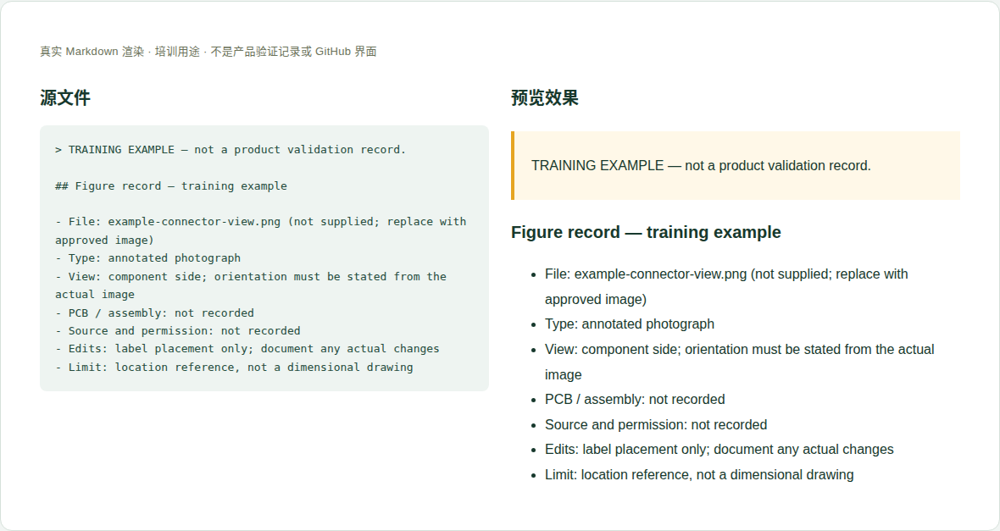

# 02 · 产品图片、接口图与资料截图

[培训首页](../README.zh-CN.md) · [网页操作步骤](../github-workflow.zh-CN.md)

## 维护目标与当前位置

让读者正确辨认外观、方向、连接器与资料出处，同时避免把示意图误当尺寸图或实测证据。

**实际源位置：** `products/mo62a/images/`

**当前状态：** 当前包含标准产品照片、接口定位 SVG、引脚示意、CAD 投影视图及历史实测截图；新增文件不会自动加入网站。

本章处理资料事实与内容。所有修改都在主题分支中完成，PR/预览/合并步骤见[网页全流程](../github-workflow.zh-CN.md)。

## 每次需要填写或核对的字段

| 字段 | 填写方法与判断依据 |
|---|---|
| 文件名 | 英文稳定名称，必要时含产品/资料修订；不要用 final2 或微信图片等临时名。 |
| 内容类型 | 实物照片、原始资料页、重绘示意、CAD 渲染、软件截图分别标明。 |
| 对象与方向 | 产品/PCB/装配版本；元件面或焊接面、上下左右参考、针脚1位置。 |
| 来源 | 原图/原始PDF/模型文件及版本，作者或机构，取得日期。 |
| 处理记录 | 裁剪、标注、翻译、脱敏、比例调整分别记录；不得改动关键事实。 |
| 图片说明与alt | 说明图展示什么、方向及局限，不能只写 image。 |
| 许可与公开范围 | 自有、获授权或第三方链接，保留相应声明。 |
| 引用位置 | 哪一页、哪一段、网站目标路径；由维护者登记assets。 |

这些字段是人工维护要求，不是已实现的Excel自动校验。填写“未记录/未测试”时同时说明缺少什么证据；不要把缺失字段改成0或默认通过。

## 网页上如何修改这一类资料

1. 用图片查看器核对原图方向与文字可读性，检查个人/客户信息。
2. 保留关键丝印、标尺和来源标识；另存新文件，不覆盖来源唯一原件。
3. 在当前分支进入 images，用 Upload files 上传 PNG/JPEG 等；复杂 SVG 标注交给软件维护者。
4. 在目标 Markdown 加有意义的图片说明与来源，申请登记网站路径。
5. 在完整站点检查桌面和手机宽度，点开原图确认细节可读。

完成后按统一流程保存英文提交标题，例如 `docs(hardware): update the reference details`。PR写明准确文件、来源、版本、实际检查和未完成项；新增页面/附件时明确请求映射处理。

## 可照着理解的填写示例

以下为教学样例。含 `EXAMPLE` / `not recorded` 的字段不是产品结论，须用已确认资料替换才可用于真实记录。引用已有公开记录的说明不代表本轮重做了硬件测试。

```markdown
## Figure record — training example

- File: example-connector-view.png (not supplied; replace with approved image)
- Type: annotated photograph
- View: component side; orientation must be stated from the actual image
- PCB / assembly: not recorded
- Source and permission: not recorded
- Edits: label placement only; document any actual changes
- Limit: location reference, not a dimensional drawing
```



图：上述文本的本地实际渲染，帮助识别填写后的层次和表格。它不是GitHub操作截图，也不是产品站或测试验收截图。

## 附件和网站接入

PNG 用于截图和带文字图，JPEG 可用于照片；保留足够分辨率但避免巨幅无用背景。不要把 CAD 尺寸图截成看不清单位的缩略图。替换旧图片须确认所有消费者，原URL尽量保持兼容。

新增源文件在GitHub可见后，请维护者确认网站映射、页面引用和导航。当前构建不会自动扫描所有资料目录生成页面。你不需要编辑 `site/` 或生成目录；交接时提供目标页面和摆放位置即可。

## 提交前逐项检查

- [ ] 朝向、针脚1、编号和正文表格一致。
- [ ] 图片未拉伸；截图能读到版本/结果所需内容。
- [ ] 没有凭空添加的尺寸、信号或实测标签。
- [ ] 所有图片可加载，alt和来源完整。
- [ ] PR差异只包含本次主题，截图/附件没有内部信息，正文与下载均在对应构建中检查。
- [ ] 已准确区分真实验证、历史记录、设计参考和训练样例。

## 常见错误与正确处理

- 把产品透视照片称为正投影尺寸图。
- 裁掉单位/来源后保留数值。
- 直接把主机桌面或聊天记录截图上传，带出内部信息。

发现上述问题时先恢复可追溯的原标识，补充来源/范围，再提交修正；不能仅删除限制文字让页面看起来完整。

## 需要交给谁处理

你确认图像内容与方向；软件维护者负责 SVG/网页映射和响应式显示，未经核对不重绘电气信息。

如果无法取得本章必需事实，在PR标明待确认项；可以先完成有证据的部分，不把未确认字段填成确定结论。涉及新的发布版本，由Admin按统一发布流程操作。
