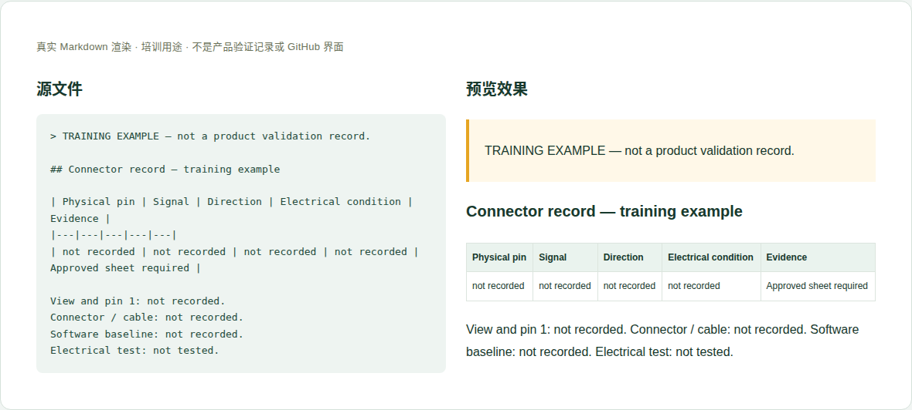

# 03 · 连接器、引脚与电气接口

[培训首页](../README.zh-CN.md) · [网页操作步骤](../github-workflow.zh-CN.md)

## 维护目标与当前位置

让集成者在断电情况下定位正确连接器、确认电气条件，再跳转软件指南配置功能。

**实际源位置：** `products/mo62a/interfaces/hardware-interfaces.en-US.md`

**当前状态：** 当前已有连接器定位、J6 40针表及部分验证范围。逻辑引脚示意、物理朝向和Linux GPIO号属于不同概念。

本章处理资料事实与内容。所有修改都在主题分支中完成，PR/预览/合并步骤见[网页全流程](../github-workflow.zh-CN.md)。

## 每次需要填写或核对的字段

| 字段 | 填写方法与判断依据 |
|---|---|
| 连接器标号/位置 | 原理图位号、丝印、外观和定位图编号；历史冲突需保留说明。 |
| 型号和机械信息 | 针数、间距、连接器/线缆型号和触点方向，有资料才写。 |
| 观察方向和针脚1 | 元件面/焊接面、插座/插头视图，不能省略。 |
| 物理针脚 | 1…N 连续编号，与原理图和图示逐项对应。 |
| 信号和方向 | 输入/输出/双向、电源/地、SoC信号名称。 |
| 电气条件 | 逻辑电压、供电、额定/极限条件、外部上拉或保护要求，注明来源。 |
| 复用与冲突 | 可选功能、独占资源；Linux控制器编号可能随软件变化。 |
| 验证范围 | 哪个接口、模式、速率和条件实际测试；未测明确写 not tested。 |
| 来源 | 原理图准确文件与sheet，以及已验证软件指南。 |

这些字段是人工维护要求，不是已实现的Excel自动校验。填写“未记录/未测试”时同时说明缺少什么证据；不要把缺失字段改成0或默认通过。

## 网页上如何修改这一类资料

1. 先找原理图对应sheet，核对位号、针脚1、信号及方向。
2. 逐行比对引脚表与定位图；发现旧SDK命名冲突时保留对照说明。
3. 更新接线前提与限制，避免把电源脚和GPIO信号脚混在一起。
4. 涉及GPIO/设备树/驱动操作时链接mo-docs，协调软件维护者核验名字和版本。
5. 在PR说明本次是设计资料核对还是新增电气测试，二者证据不同。

完成后按统一流程保存英文提交标题，例如 `docs(hardware): update the reference details`。PR写明准确文件、来源、版本、实际检查和未完成项；新增页面/附件时明确请求映射处理。

## 可照着理解的填写示例

以下为教学样例。含 `EXAMPLE` / `not recorded` 的字段不是产品结论，须用已确认资料替换才可用于真实记录。引用已有公开记录的说明不代表本轮重做了硬件测试。

```markdown
## Connector record — training example

| Physical pin | Signal | Direction | Electrical condition | Evidence |
|---|---|---|---|---|
| not recorded | not recorded | not recorded | not recorded | Approved sheet required |

View and pin 1: not recorded.
Connector / cable: not recorded.
Software baseline: not recorded.
Electrical test: not tested.
```



图：上述文本的本地实际渲染，帮助识别填写后的层次和表格。它不是GitHub操作截图，也不是产品站或测试验收截图。

## 附件和网站接入

定位图和针脚图分别说明用途。原理图截图需要保留sheet/版本，不能只凭截出的单个标号推断全板。新增外接件资料引用批准型号，不因针数相同就宣称兼容。

新增源文件在GitHub可见后，请维护者确认网站映射、页面引用和导航。当前构建不会自动扫描所有资料目录生成页面。你不需要编辑 `site/` 或生成目录；交接时提供目标页面和摆放位置即可。

## 提交前逐项检查

- [ ] 所有物理针脚连续且无重复/遗漏。
- [ ] 方向与真实连接面一致，电压和电源边界明确。
- [ ] 接线描述与图表一致，软件映射没有当固定物理编号。
- [ ] 测试范围不扩大到未测接口或任意HAT。
- [ ] PR差异只包含本次主题，截图/附件没有内部信息，正文与下载均在对应构建中检查。
- [ ] 已准确区分真实验证、历史记录、设计参考和训练样例。

## 常见错误与正确处理

- 把GPIO17当物理17脚或Linux GPIO offset。
- 把J5变压器抽头写成受控5V输出。
- 只凭接口外形宣称HAT/相机排线兼容。

发现上述问题时先恢复可追溯的原标识，补充来源/范围，再提交修正；不能仅删除限制文字让页面看起来完整。

## 需要交给谁处理

硬件确认连接和电气条件；软件核对pinmux、驱动和Linux映射；新实测由相应验证记录支撑。

如果无法取得本章必需事实，在PR标明待确认项；可以先完成有证据的部分，不把未确认字段填成确定结论。涉及新的发布版本，由Admin按统一发布流程操作。
