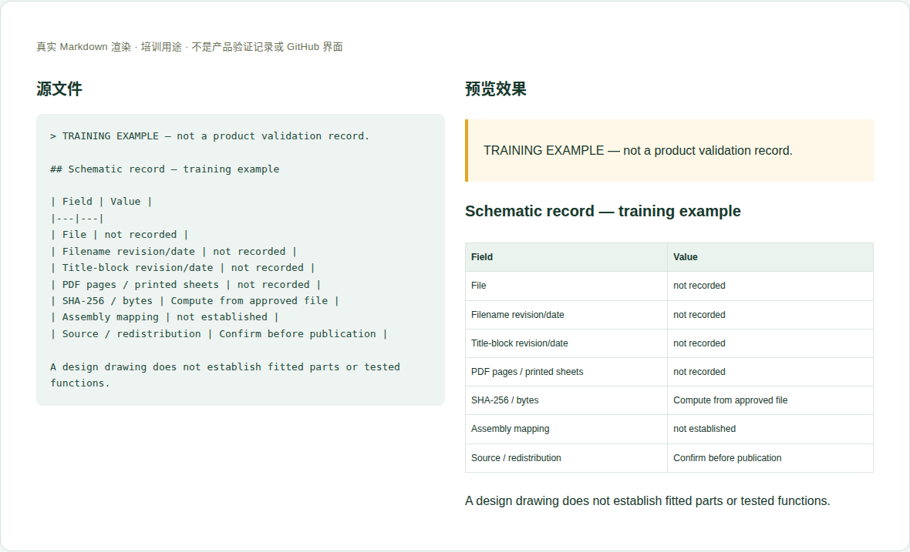

# 04 · 原理图与模块说明

[培训首页](../README.zh-CN.md) · [网页操作步骤](../github-workflow.zh-CN.md)

## 维护目标与当前位置

提供可追溯的电路设计来源，并指导读者定位模块；不把原理图元件清单等同于实际装配BOM。

**实际源位置：** `products/mo62a/schematics/schematics.en-US.md；附件 products/mo62a/schematics/files/`

**当前状态：** 本仓库已存两份完整PDF；不是Git LFS指针。文件名与标题栏修订/日期存在已记录差异，不可自行“修正”为一致。

本章处理资料事实与内容。所有修改都在主题分支中完成，PR/预览/合并步骤见[网页全流程](../github-workflow.zh-CN.md)。

## 每次需要填写或核对的字段

| 字段 | 填写方法与判断依据 |
|---|---|
| 准确文件名 | 保留发布者原名；新文件名需含可追溯修订，不能覆盖旧来源含义。 |
| 文件大小和SHA-256 | 由实际字节计算，文件变更后必须重算。 |
| 标题栏信息 | 原文型号、修订、日期，与文件名分别记录。 |
| 页/Sheet对应 | PDF查看器页码和图纸sheet可能不同，逐项核对。 |
| 适用装配 | 关联PCB/BOM版本的依据；没有映射写 not established。 |
| 模块与网络 | 电源、处理器、内存、接口等，说明跨页信号如何连接。 |
| 来源与许可 | 原始公开位置、来源提交/版本、公开授权边界。 |
| 设计/实装/测试 | 区分图纸画出、实际焊装、功能通过三个状态。 |

这些字段是人工维护要求，不是已实现的Excel自动校验。填写“未记录/未测试”时同时说明缺少什么证据；不要把缺失字段改成0或默认通过。

## 网页上如何修改这一类资料

1. 用PDF查看器打开每页，核对页数、标题栏和完整性。
2. 在files上传获准公开的完整PDF，保留旧版本；请维护者计算大小/哈希并登记下载。
3. 更新正文下载表，填写文件标识、来源、大小与SHA。
4. 按sheet检查模块说明、图片与连接关系；冲突写成可追溯差异。
5. 重新下载构建后的文件，对比原始文件哈希，避免上传了指针或损坏附件。

完成后按统一流程保存英文提交标题，例如 `docs(hardware): update the reference details`。PR写明准确文件、来源、版本、实际检查和未完成项；新增页面/附件时明确请求映射处理。

## 可照着理解的填写示例

以下为教学样例。含 `EXAMPLE` / `not recorded` 的字段不是产品结论，须用已确认资料替换才可用于真实记录。引用已有公开记录的说明不代表本轮重做了硬件测试。

```markdown
## Schematic record — training example

| Field | Value |
|---|---|
| File | not recorded |
| Filename revision/date | not recorded |
| Title-block revision/date | not recorded |
| PDF pages / printed sheets | not recorded |
| SHA-256 / bytes | Compute from approved file |
| Assembly mapping | not established |
| Source / redistribution | Confirm before publication |

A design drawing does not establish fitted parts or tested functions.
```



图：上述文本的本地实际渲染，帮助识别填写后的层次和表格。它不是GitHub操作截图，也不是产品站或测试验收截图。

## 附件和网站接入

PDF是原始电路参考，英文重绘图应另命名并声明翻译/重绘和来源sheet。不要用重绘图替换原PDF。网页上传超过25MiB时由维护者本地提交；仓库最大50MiB。

新增源文件在GitHub可见后，请维护者确认网站映射、页面引用和导航。当前构建不会自动扫描所有资料目录生成页面。你不需要编辑 `site/` 或生成目录；交接时提供目标页面和摆放位置即可。

## 提交前逐项检查

- [ ] 所有PDF页可打开，文件名、字节数、哈希一致。
- [ ] 标题栏和文件名差异未被掩盖。
- [ ] 预览图来自正确版本和sheet。
- [ ] 下载URL有效；在当前仓库执行的是products路径而非BSP仓库路径。
- [ ] PR差异只包含本次主题，截图/附件没有内部信息，正文与下载均在对应构建中检查。
- [ ] 已准确区分真实验证、历史记录、设计参考和训练样例。

## 常见错误与正确处理

- 上传几十字节的LFS指针当PDF。
- 把标题栏V1.0擅自改成文件名里的V11。
- 用图纸某器件型号宣称所有出货板都焊装该型号。

发现上述问题时先恢复可追溯的原标识，补充来源/范围，再提交修正；不能仅删除限制文字让页面看起来完整。

## 需要交给谁处理

硬件提供完整来源和模块核对；软件维护者登记文件映射并核对哈希；装配对应关系由设计/BOM责任人确认。

如果无法取得本章必需事实，在PR标明待确认项；可以先完成有证据的部分，不把未确认字段填成确定结论。涉及新的发布版本，由Admin按统一发布流程操作。
