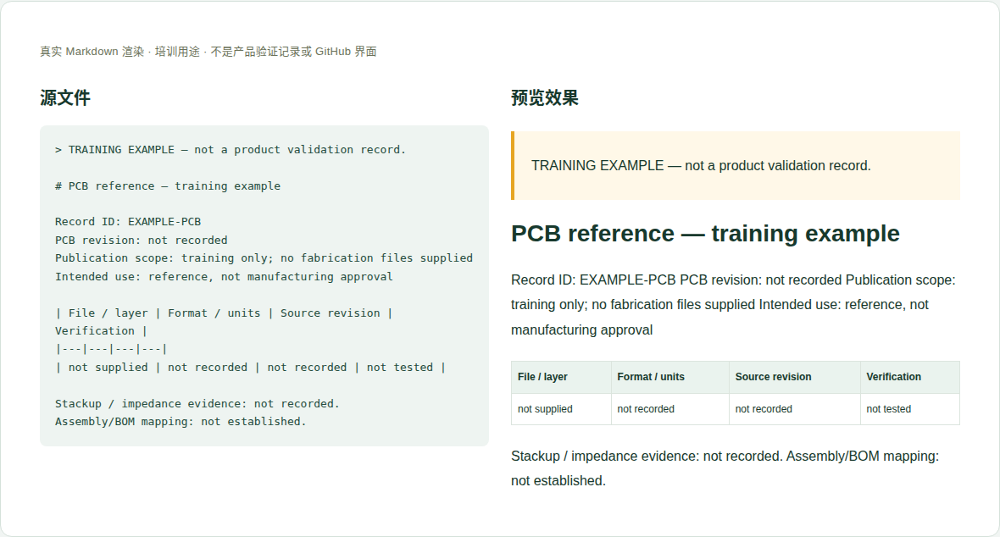

# 05 · PCB资料与制造边界

[培训首页](../README.zh-CN.md) · [网页操作步骤](../github-workflow.zh-CN.md)

## 维护目标与当前位置

对明确获准公开的PCB资料说明层次、版本、用途和限制，避免把开发参考当制造放行。

**实际源位置：** `products/mo62a/pcb/（当前只有预留标记）`

**当前状态：** 尚无已发布PCB记录或独立网站页面。准备第一份公开资料时需同时请维护者设计页面映射，不能将空目录理解为Gerber已可下载。

本章处理资料事实与内容。所有修改都在主题分支中完成，PR/预览/合并步骤见[网页全流程](../github-workflow.zh-CN.md)。

## 每次需要填写或核对的字段

| 字段 | 填写方法与判断依据 |
|---|---|
| 记录ID与PCB版本 | 稳定记录名、准确PCB编号/版本，不能用网站版本代替。 |
| 资料类型 | 叠层说明、布局预览、Gerber、钻孔、装配图等逐项列出。 |
| 文件集合与工具 | 导出工具版本、格式、层清单、单位、导出日期。 |
| 完整性 | 每个必需层/钻孔文件是否存在，压缩包清单及哈希。 |
| 板材/叠层/阻抗 | 只引用批准的制造资料；设计目标与实测结果分开。 |
| 适用装配与差异 | 是否有装配/BOM变更，来源是否能建立对应关系。 |
| 用途和批准范围 | 公开参考、可制造资料或正式制造放行由责任人明确。 |
| 公开/第三方范围 | EDA库、芯片封装、供应商文档及客户设计逐项确认。 |

这些字段是人工维护要求，不是已实现的Excel自动校验。填写“未记录/未测试”时同时说明缺少什么证据；不要把缺失字段改成0或默认通过。

## 网页上如何修改这一类资料

1. 先由PCB责任人确认可公开的资料清单和用途，不整体上传内部工程。
2. 在主题分支新建 pcb/<稳定ID>/description.en-US.md，填写字段和文件清单。
3. 上传批准的附件到该记录files/；解压检查目录、单位、层和工具可读性。
4. 请维护者安排页面位置与下载映射，并说明是否只作为仓库资料。
5. PR明确“非制造放行”或引用真实放行依据，不用CI通过替代设计批准。

完成后按统一流程保存英文提交标题，例如 `docs(hardware): update the reference details`。PR写明准确文件、来源、版本、实际检查和未完成项；新增页面/附件时明确请求映射处理。

## 可照着理解的填写示例

以下为教学样例。含 `EXAMPLE` / `not recorded` 的字段不是产品结论，须用已确认资料替换才可用于真实记录。引用已有公开记录的说明不代表本轮重做了硬件测试。

```markdown
# PCB reference — training example

Record ID: EXAMPLE-PCB
PCB revision: not recorded
Publication scope: training only; no fabrication files supplied
Intended use: reference, not manufacturing approval

| File / layer | Format / units | Source revision | Verification |
|---|---|---|---|
| not supplied | not recorded | not recorded | not tested |

Stackup / impedance evidence: not recorded.
Assembly/BOM mapping: not established.
```



图：上述文本的本地实际渲染，帮助识别填写后的层次和表格。它不是GitHub操作截图，也不是产品站或测试验收截图。

## 附件和网站接入

若提供Gerber/钻孔ZIP，应包含文件清单、单位、层名与来源，不含临时缓存、绝对路径、客户项目或未授权EDA库。查看器渲染成功也不表示可制造。

新增源文件在GitHub可见后，请维护者确认网站映射、页面引用和导航。当前构建不会自动扫描所有资料目录生成页面。你不需要编辑 `site/` 或生成目录；交接时提供目标页面和摆放位置即可。

## 提交前逐项检查

- [ ] 批准公开的清单与压缩包内容一一对应。
- [ ] 板材、叠层、阻抗和单位都有明确来源。
- [ ] 用途和制造批准状态写清。
- [ ] 新页面/下载映射有明确维护者负责，不停留在只上传文件。
- [ ] PR差异只包含本次主题，截图/附件没有内部信息，正文与下载均在对应构建中检查。
- [ ] 已准确区分真实验证、历史记录、设计参考和训练样例。

## 常见错误与正确处理

- 把内部EDA工程整个拖进公开仓库。
- 将参考Gerber描述为已通过生产验收。
- 用PCB版本替代装配版本，遗漏物料差异。

发现上述问题时先恢复可追溯的原标识，补充来源/范围，再提交修正；不能仅删除限制文字让页面看起来完整。

## 需要交给谁处理

硬件/PCB责任人决定公开与技术范围；软件维护者负责初次页面接入和自动检查；制造放行由有相应职责的人确认。

如果无法取得本章必需事实，在PR标明待确认项；可以先完成有证据的部分，不把未确认字段填成确定结论。涉及新的发布版本，由Admin按统一发布流程操作。
