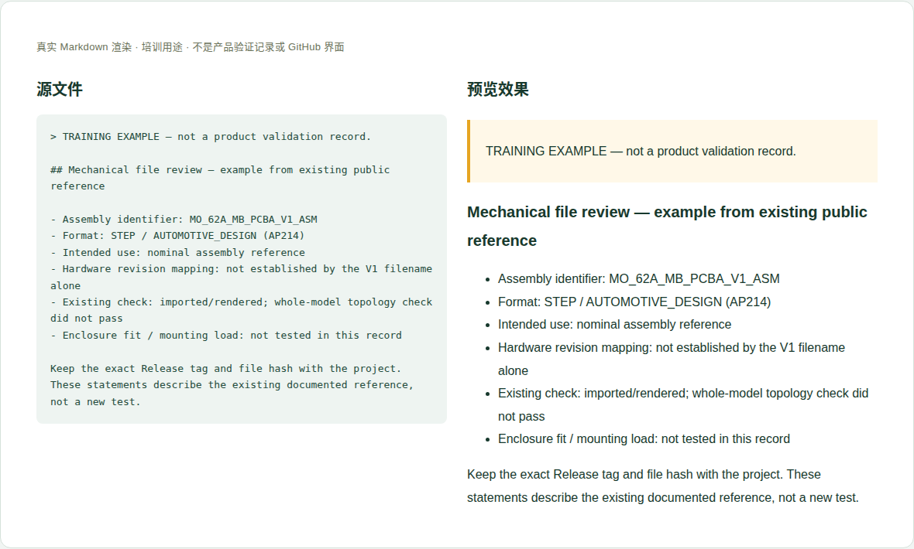

# 06 · 机械模型、尺寸与装配参考

[培训首页](../README.zh-CN.md) · [网页操作步骤](../github-workflow.zh-CN.md)

## 维护目标与当前位置

帮助读者选择正确模型、核对字节与单位，理解名义几何和制造/装配验证之间的差别。

**实际源位置：** `products/mo62a/mechanical/mechanical.en-US.md；附件 products/mo62a/mechanical/files/`

**当前状态：** 已发布STEP ZIP、ZIP和解压STEP的哈希、README说明及CAD投影。模型能导入，但历史OpenCascade整模型拓扑检查未通过，不能删掉这一边界。

本章处理资料事实与内容。所有修改都在主题分支中完成，PR/预览/合并步骤见[网页全流程](../github-workflow.zh-CN.md)。

## 每次需要填写或核对的字段

| 字段 | 填写方法与判断依据 |
|---|---|
| 模型/图纸身份 | 装配标识、文件名、格式和资料修订。 |
| 来源与导出 | 提供者、CAD工具、导出时间及其含义，导出日期不是硬件发布日期。 |
| 硬件对应关系 | PCB/装配/BOM版本及确认来源；无法确认明确记录。 |
| 单位/尺寸类型 | mm等单位；PCB外形、整机包络、孔位、带插头空间分别说明。 |
| 尺寸依据与公差 | 来自图纸、CAD计算或实测，是否有公差和制造许可。 |
| 完整性与CAD检查 | ZIP/STEP哈希、解压清单、导入工具版本、几何/拓扑结果。 |
| 用途与未验证项 | 参考、设计、制造、壳体配合等各自范围。 |
| 附件来源/许可 | 第三方组件模型权利与公开范围，不因去掉作者字段就成为自有模型。 |

这些字段是人工维护要求，不是已实现的Excel自动校验。填写“未记录/未测试”时同时说明缺少什么证据；不要把缺失字段改成0或默认通过。

## 网页上如何修改这一类资料

1. 读取现有模型README和机械页，保留原模型的来源/检查边界。
2. 新模型使用可追溯文件名，上传前解压并在CAD查看器打开，确认单位。
3. 请维护者计算归档和解压文件哈希，更新正文/说明/校验文件的同一版本。
4. 补充CAD检查方法、结果和用途；未做配合/载荷测试就写未测。
5. 在站点点开下载，核对字节和版本；图片说明写明是CAD投影还是照片。

完成后按统一流程保存英文提交标题，例如 `docs(hardware): update the reference details`。PR写明准确文件、来源、版本、实际检查和未完成项；新增页面/附件时明确请求映射处理。

## 可照着理解的填写示例

以下为教学样例。含 `EXAMPLE` / `not recorded` 的字段不是产品结论，须用已确认资料替换才可用于真实记录。引用已有公开记录的说明不代表本轮重做了硬件测试。

```markdown
## Mechanical file review — example from existing public reference

- Assembly identifier: MO_62A_MB_PCBA_V1_ASM
- Format: STEP / AUTOMOTIVE_DESIGN (AP214)
- Intended use: nominal assembly reference
- Hardware revision mapping: not established by the V1 filename alone
- Existing check: imported/rendered; whole-model topology check did not pass
- Enclosure fit / mounting load: not tested in this record

Keep the exact Release tag and file hash with the project.
These statements describe the existing documented reference, not a new test.
```



图：上述文本的本地实际渲染，帮助识别填写后的层次和表格。它不是GitHub操作截图，也不是产品站或测试验收截图。

## 附件和网站接入

保留ZIP与解压STEP各自哈希；尺寸图需要单位、比例/不按比例说明、公差和来源。真实CAD数据不使用图片重建替代。换文件后重新检查下载映射与旧链接兼容。

新增源文件在GitHub可见后，请维护者确认网站映射、页面引用和导航。当前构建不会自动扫描所有资料目录生成页面。你不需要编辑 `site/` 或生成目录；交接时提供目标页面和摆放位置即可。

## 提交前逐项检查

- [ ] 下载包、解压文件、校验文件和正文引用一致。
- [ ] 单位明确，板外形与全装配包络没有混淆。
- [ ] “可以显示”没有写成“几何完全有效”。
- [ ] 没有把名义模型写成量产公差图或壳体适配保证。
- [ ] PR差异只包含本次主题，截图/附件没有内部信息，正文与下载均在对应构建中检查。
- [ ] 已准确区分真实验证、历史记录、设计参考和训练样例。

## 常见错误与正确处理

- 模型V1等同于原理图V1.0或所有出货板。
- 把整装配包络当PCB85×56mm尺寸。
- 修改STEP后沿用旧SHA256。

发现上述问题时先恢复可追溯的原标识，补充来源/范围，再提交修正；不能仅删除限制文字让页面看起来完整。

## 需要交给谁处理

硬件确认模型适用性和使用限制；软件维护者处理压缩包/哈希/下载；结构与制造责任人确认公差和装配验收。

如果无法取得本章必需事实，在PR标明待确认项；可以先完成有证据的部分，不把未确认字段填成确定结论。涉及新的发布版本，由Admin按统一发布流程操作。
