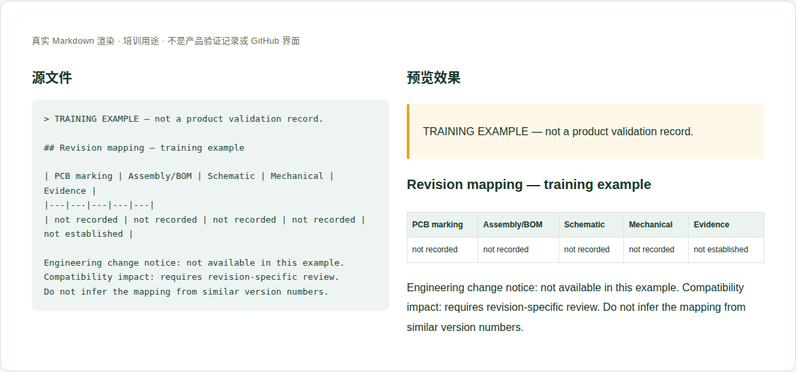

# 07 · 硬件版本与变更记录

[培训首页](../README.zh-CN.md) · [网页操作步骤](../github-workflow.zh-CN.md)

## 维护目标与当前位置

使读者能把实际板卡和正确资料对应起来，同时清楚哪些对应关系尚未建立。

**实际源位置：** `products/mo62a/revisions/hardware-revisions.en-US.md`

**当前状态：** 当前有识别方法和已知文件标识差异，没有权威ECN、装配变化表或序列号映射。

本章处理资料事实与内容。所有修改都在主题分支中完成，PR/预览/合并步骤见[网页全流程](../github-workflow.zh-CN.md)。

## 每次需要填写或核对的字段

| 字段 | 填写方法与判断依据 |
|---|---|
| PCB标识 | 从实际丝印完整抄写，包含标点与相邻标识。 |
| 装配/BOM版本 | 供应方或装配记录中的独立版本，未获提供就说明。 |
| 序列/批次范围 | 仅在批准的公开范围内表达，个体序列号走适当支持渠道。 |
| ECN/变更记录 | 编号、日期、责任来源和公开链接；没有时不能自行生成事实记录。 |
| 变更内容 | 改了哪些器件/接口/结构，设计变化和实际装配区分。 |
| 匹配资料 | 原理图、机械、PCB文件的版本和哈希。 |
| 兼容影响 | 电源、配件、软件、散热、结构方面需重验证的项目。 |
| 识别方法 | 经过验证的丝印/标签/软件读取方法及限制。 |

这些字段是人工维护要求，不是已实现的Excel自动校验。填写“未记录/未测试”时同时说明缺少什么证据；不要把缺失字段改成0或默认通过。

## 网页上如何修改这一类资料

1. 从批准来源取得版本/变更资料，准确记录原文标识。
2. 更新对应表，注明适用板卡或批次范围；不要以文件名排序推断发布日期。
3. 每个变更连接到具体资料或ECN，写清需重新验证哪些项目。
4. 仅公开可分享的批次范围；照片中的个体序列号要按公开范围处理。
5. 核对overview、接口、原理图、机械及配件兼容是否需要同步说明。

完成后按统一流程保存英文提交标题，例如 `docs(hardware): update the reference details`。PR写明准确文件、来源、版本、实际检查和未完成项；新增页面/附件时明确请求映射处理。

## 可照着理解的填写示例

以下为教学样例。含 `EXAMPLE` / `not recorded` 的字段不是产品结论，须用已确认资料替换才可用于真实记录。引用已有公开记录的说明不代表本轮重做了硬件测试。

```markdown
## Revision mapping — training example

| PCB marking | Assembly/BOM | Schematic | Mechanical | Evidence |
|---|---|---|---|---|
| not recorded | not recorded | not recorded | not recorded | not established |

Engineering change notice: not available in this example.
Compatibility impact: requires revision-specific review.
Do not infer the mapping from similar version numbers.
```



图：上述文本的本地实际渲染，帮助识别填写后的层次和表格。它不是GitHub操作截图，也不是产品站或测试验收截图。

## 附件和网站接入

照片应显示必要丝印和方向；内部工单/供应商BOM不可直接公开。公开ECN附件需确认范围，指向具体修订，不使用会被随意覆盖的临时链接。

新增源文件在GitHub可见后，请维护者确认网站映射、页面引用和导航。当前构建不会自动扫描所有资料目录生成页面。你不需要编辑 `site/` 或生成目录；交接时提供目标页面和摆放位置即可。

## 提交前逐项检查

- [ ] PCB、装配、文件和软件版本分别表达。
- [ ] 映射有正式来源，未知未被自动补齐。
- [ ] 序列/批次公开范围合适。
- [ ] 兼容影响和重新验证要求可执行。
- [ ] PR差异只包含本次主题，截图/附件没有内部信息，正文与下载均在对应构建中检查。
- [ ] 已准确区分真实验证、历史记录、设计参考和训练样例。

## 常见错误与正确处理

- 用uname、设备树model或RTC驱动名判定PCB版本。
- 把原理图文件名后缀当制造日期。
- 自己根据两份PDF差异生成“正式变更历史”。

发现上述问题时先恢复可追溯的原标识，补充来源/范围，再提交修正；不能仅删除限制文字让页面看起来完整。

## 需要交给谁处理

设计/装配责任人提供权威映射；你负责准确记录和关联；软件维护者只实现经证据支持的识别指引。

如果无法取得本章必需事实，在PR标明待确认项；可以先完成有证据的部分，不把未确认字段填成确定结论。涉及新的发布版本，由Admin按统一发布流程操作。
