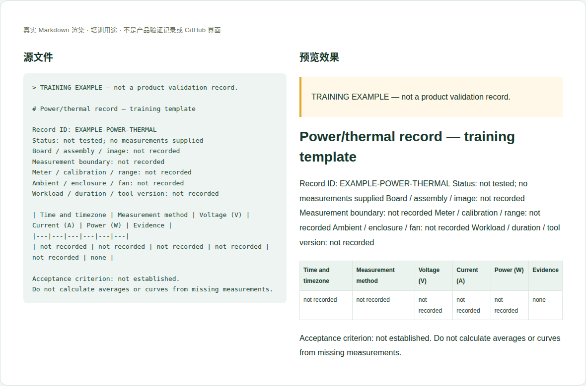

# 08 · 功耗、温度与散热验证

[培训首页](../README.zh-CN.md) · [网页操作步骤](../github-workflow.zh-CN.md)

## 维护目标与当前位置

使另一名工程师能理解测量边界、复现条件并检查结论，不把额定值、手工读数和时间序列混用。

**实际源位置：** `products/mo62a/validation/power-thermal/；已有入口 power-and-thermal.en-US.md`

**当前状态：** 现有页只有产品额定值与一次只读传感器截图；新增工作负载测量必须单独提供原始数据和方法。待审的内部测量不能未经确认带入公开资料。

本章处理资料事实与内容。所有修改都在主题分支中完成，PR/预览/合并步骤见[网页全流程](../github-workflow.zh-CN.md)。

## 每次需要填写或核对的字段

| 字段 | 填写方法与判断依据 |
|---|---|
| 记录ID/日期 | 稳定ID、起止时间与时区，操作者可公开署名。 |
| 样机配置 | PCB/装配、内存、镜像、内核、启动项、模型/工具版本。 |
| 测量边界 | 适配器AC侧、USB-C直流输入还是某电源轨；明确包含的外设。 |
| 仪器与方法 | 功率计/电压电流表型号、量程、精度/校准状态、采样或手读方法。 |
| 环境与散热 | 环境温度、壳体、散热片、风扇、气流和供电线。 |
| 工作负载 | 空闲/CPU/NPU/相机的具体命令、版本、持续时间与稳定判据。 |
| 原始数据 | 带单位的电压/电流/功率/传感器读数，时间戳或手读时点。 |
| 传感器身份 | thermal_zone的type、路径、单位；不能只写温度1。 |
| 统计与结论 | 样本数、时间窗口、平均/最大定义和异常处理，明确未覆盖范围。 |
| 验收标准 | 标准来源及阈值，在测试前定义；无标准时只报观察结果。 |

这些字段是人工维护要求，不是已实现的Excel自动校验。填写“未记录/未测试”时同时说明缺少什么证据；不要把缺失字段改成0或默认通过。

## 网页上如何修改这一类资料

1. 先写测试计划、量测边界和判定方法，确认样机与仪器。
2. 保留原始CSV/日志；手工读数逐条记时间与条件，不伪造均匀采样序列。
3. 在 power-thermal/<记录ID>/ 新建说明和files，把公开脱敏后的数据上传。
4. 复算单位、功率和统计，区分SoC内部温度与环境温度。
5. 请维护者把记录链接到现有页面；只有实际时间序列才画随时间曲线。

完成后按统一流程保存英文提交标题，例如 `docs(hardware): update the reference details`。PR写明准确文件、来源、版本、实际检查和未完成项；新增页面/附件时明确请求映射处理。

## 可照着理解的填写示例

以下为教学样例。含 `EXAMPLE` / `not recorded` 的字段不是产品结论，须用已确认资料替换才可用于真实记录。引用已有公开记录的说明不代表本轮重做了硬件测试。

```markdown
# Power/thermal record — training template

Record ID: EXAMPLE-POWER-THERMAL
Status: not tested; no measurements supplied
Board / assembly / image: not recorded
Measurement boundary: not recorded
Meter / calibration / range: not recorded
Ambient / enclosure / fan: not recorded
Workload / duration / tool version: not recorded

| Time and timezone | Measurement method | Voltage (V) | Current (A) | Power (W) | Evidence |
|---|---|---|---|---|---|
| not recorded | not recorded | not recorded | not recorded | not recorded | none |

Acceptance criterion: not established.
Do not calculate averages or curves from missing measurements.
```



图：上述文本的本地实际渲染，帮助识别填写后的层次和表格。它不是GitHub操作截图，也不是产品站或测试验收截图。

## 附件和网站接入

原始数据、条件说明和汇总一起提交；CSV列名注明单位。传感器日志不是整板功率计读数。截图只辅助说明接线/仪器，不替代原始数据。

新增源文件在GitHub可见后，请维护者确认网站映射、页面引用和导航。当前构建不会自动扫描所有资料目录生成页面。你不需要编辑 `site/` 或生成目录；交接时提供目标页面和摆放位置即可。

## 提交前逐项检查

- [ ] 每组数据都能追溯样机、软件、仪器和环境。
- [ ] V×A计算仅用于对应同时测得的直流边界，不混AC侧或不同时点。
- [ ] 样本数量和统计可复算，缺失值没有填0。
- [ ] 短时观察没有写成稳态、额定最大值或独立MMA利用率。
- [ ] PR差异只包含本次主题，截图/附件没有内部信息，正文与下载均在对应构建中检查。
- [ ] 已准确区分真实验证、历史记录、设计参考和训练样例。

## 常见错误与正确处理

- 把25W产品额定上限写成实测满载。
- 把单次温度读数当热稳态。
- 将六个手读工况连成“随时间曲线”。

发现上述问题时先恢复可追溯的原标识，补充来源/范围，再提交修正；不能仅删除限制文字让页面看起来完整。

## 现有概览页与新测试记录怎么分工

`power-and-thermal.en-US.md` 维护供电额定值、接线边界、风扇接口和传感器读取说明。新增某次负载测量时，不要直接把既有额定值改成测量值；在带稳定ID的子目录保存条件/数据/结论，再在概览页增加“实测记录”链接和范围摘要。若改变读取命令，需软件维护者核验对应镜像，不能把别的Linux设备编号照搬过来。

## 需要交给谁处理

硬件/测试人员负责仪器、量测与边界；软件人员提供可追溯负载和日志工具；统计和图表由双方核对后接入。

如果无法取得本章必需事实，在PR标明待确认项；可以先完成有证据的部分，不把未确认字段填成确定结论。涉及新的发布版本，由Admin按统一发布流程操作。
