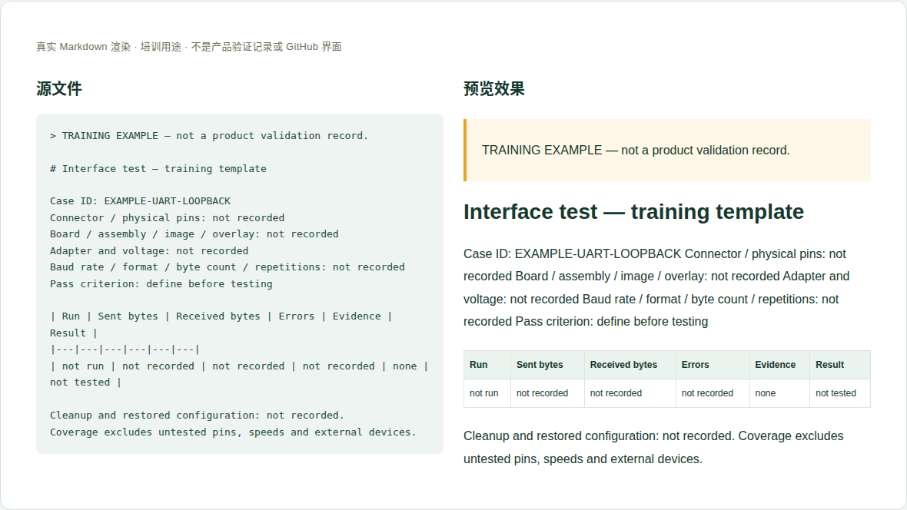

# 09 · 接口功能与电气验证记录

[培训首页](../README.zh-CN.md) · [网页操作步骤](../github-workflow.zh-CN.md)

## 维护目标与当前位置

把“接口在什么条件下通过什么测试”写成能复查的记录，区别设计参考、单次连通和完整兼容认证。

**实际源位置：** `products/mo62a/validation/interfaces/（当前为预留目录）`

**当前状态：** 当前产品页引用软件文档中的部分GPIO/UART/PWM实测；本目录没有独立结构化测试记录。新增记录需公开原始证据并链接到相关页。

本章处理资料事实与内容。所有修改都在主题分支中完成，PR/预览/合并步骤见[网页全流程](../github-workflow.zh-CN.md)。

## 每次需要填写或核对的字段

| 字段 | 填写方法与判断依据 |
|---|---|
| 记录/用例ID | 稳定名称，说明测哪个连接器、通道和功能。 |
| 样机和软件 | PCB/装配、镜像、内核、设备树/启动项、工具版本。 |
| 外部设备 | 外设型号/修订、线缆、适配器、仪器及配置。 |
| 接线和电气条件 | 物理针脚、信号方向、电压、地、隔离和断电接线要求。 |
| 步骤和激励 | 实际操作顺序、频率/速率、数据长度、循环次数/时长。 |
| 判定条件 | 成功/失败阈值及依据，最好测试前固定。 |
| 原始证据 | 终端日志、示波器文件、CSV、照片，带时间和用例标识。 |
| 结果与异常 | 通过/失败/未测分开，丢包、误差、恢复过程记录。 |
| 范围和恢复 | 仅哪些通道/模式通过；测试后恢复的配置与未恢复项。 |

这些字段是人工维护要求，不是已实现的Excel自动校验。填写“未记录/未测试”时同时说明缺少什么证据；不要把缺失字段改成0或默认通过。

## 网页上如何修改这一类资料

1. 定义单个用例，不把多个接口笼统写成“全部通过”。
2. 记录样机、连接和软件条件，按已验证操作执行，原始数据保留。
3. 新建 interfaces/<用例ID>/description.en-US.md 与files，填写方法/结果/异常。
4. 与软件指南确认控制器名和pinmux；把必要操作链接到mo-docs。
5. 在接口页增加针对性引用，表述为该用例范围内通过，未测项保持未知。

完成后按统一流程保存英文提交标题，例如 `docs(hardware): update the reference details`。PR写明准确文件、来源、版本、实际检查和未完成项；新增页面/附件时明确请求映射处理。

## 可照着理解的填写示例

以下为教学样例。含 `EXAMPLE` / `not recorded` 的字段不是产品结论，须用已确认资料替换才可用于真实记录。引用已有公开记录的说明不代表本轮重做了硬件测试。

```markdown
# Interface test — training template

Case ID: EXAMPLE-UART-LOOPBACK
Connector / physical pins: not recorded
Board / assembly / image / overlay: not recorded
Adapter and voltage: not recorded
Baud rate / format / byte count / repetitions: not recorded
Pass criterion: define before testing

| Run | Sent bytes | Received bytes | Errors | Evidence | Result |
|---|---|---|---|---|---|
| not run | not recorded | not recorded | not recorded | none | not tested |

Cleanup and restored configuration: not recorded.
Coverage excludes untested pins, speeds and external devices.
```



图：上述文本的本地实际渲染，帮助识别填写后的层次和表格。它不是GitHub操作截图，也不是产品站或测试验收截图。

## 附件和网站接入

波形应带时间刻度、电压刻度、探头倍率和测量点；日志带版本/参数。图片中隐藏无关个人信息但不要删除判断结果所需的上下文。

新增源文件在GitHub可见后，请维护者确认网站映射、页面引用和导航。当前构建不会自动扫描所有资料目录生成页面。你不需要编辑 `site/` 或生成目录；交接时提供目标页面和摆放位置即可。

## 提交前逐项检查

- [ ] 另一名工程师能按记录复查配置和方法。
- [ ] 成功标准与结果对应，失败记录未被删除。
- [ ] 针脚/模式/速率与结论一一对应。
- [ ] 恢复步骤真实完成，未完成明确记录。
- [ ] PR差异只包含本次主题，截图/附件没有内部信息，正文与下载均在对应构建中检查。
- [ ] 已准确区分真实验证、历史记录、设计参考和训练样例。

## 常见错误与正确处理

- 只写passed，没有方法、次数或证据。
- 某一针脚PWM通过就写全部PWM已验证。
- 没有外部I²C器件测试却宣称I²C兼容全部配件。

发现上述问题时先恢复可追溯的原标识，补充来源/范围，再提交修正；不能仅删除限制文字让页面看起来完整。

## 需要交给谁处理

测试工程师负责原始记录和判定；软件维护者核实驱动/工具行为并接入链接；涉及新接线必须先确认电气条件。

如果无法取得本章必需事实，在PR标明待确认项；可以先完成有证据的部分，不把未确认字段填成确定结论。涉及新的发布版本，由Admin按统一发布流程操作。
