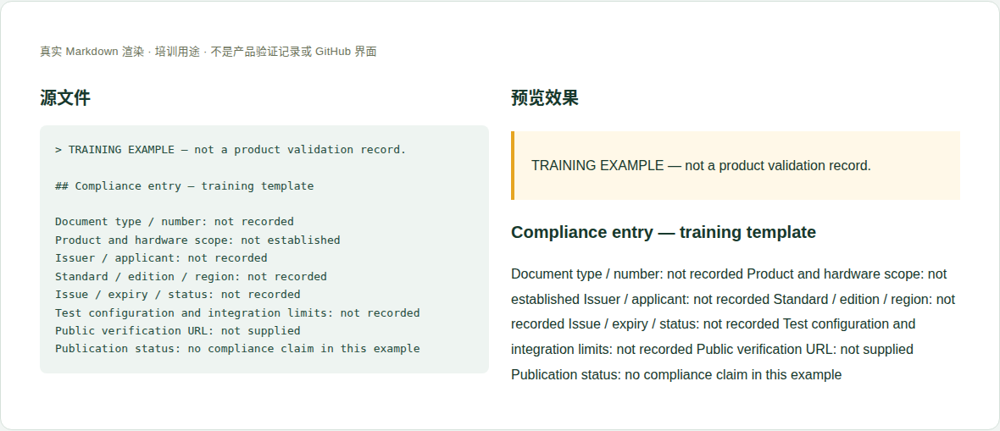

# 10 · 合规、证书、声明与集成说明

[培训首页](../README.zh-CN.md) · [网页操作步骤](../github-workflow.zh-CN.md)

## 维护目标与当前位置

准确表达哪个产品/版本在什么范围内有哪份有效材料，让集成者知道限制和需要继续确认的事项。

**实际源位置：** `products/mo62a/compliance/：certifications、declarations、integration-notes、regulatory-and-safety.en-US.md`

**当前状态：** 当前页面为Coming soon，没有可据此宣称的证书编号或完成状态。章节说明的是如何提交真实文件，不代替合规部门判断。

本章处理资料事实与内容。所有修改都在主题分支中完成，PR/预览/合并步骤见[网页全流程](../github-workflow.zh-CN.md)。

## 每次需要填写或核对的字段

| 字段 | 填写方法与判断依据 |
|---|---|
| 材料类型 | 证书、测试报告、符合性声明、安装/安全说明区分。 |
| 文件身份 | 编号、标题、修订、签发/更新/有效日期，抄原文。 |
| 主体与对象 | 制造商/申请人、产品型号、硬件/装配、无线模块及天线等适用范围。 |
| 标准与区域 | 准确标准/版本、国家/区域，不能笼统“全球认证”。 |
| 签发/测试机构 | 原文机构与可公开验证渠道。 |
| 配置与限制 | 测试样品、天线/电源/外壳/软件配置和集成条件。 |
| 公开附件与来源 | 文件公开授权、完整性、脱敏说明、官方验证链接。 |
| 状态和差异 | 有效、待确认、过期、撤销、仅模块级等据实区分。 |

这些字段是人工维护要求，不是已实现的Excel自动校验。填写“未记录/未测试”时同时说明缺少什么证据；不要把缺失字段改成0或默认通过。

## 网页上如何修改这一类资料

1. 从合规责任人取得允许公开的文件和准确适用范围。
2. 根据类型选择certifications或declarations页面，集成限制另写integration-notes。
3. 上传获准公开的文件并保留编号、来源和必要说明；请维护者登记下载。
4. 逐项核对标准版本、产品范围、日期和附件一致性。
5. 只有材料足以支持时才替换对应Coming soon内容，不能整栏统一标已完成。

完成后按统一流程保存英文提交标题，例如 `docs(hardware): update the reference details`。PR写明准确文件、来源、版本、实际检查和未完成项；新增页面/附件时明确请求映射处理。

## 可照着理解的填写示例

以下为教学样例。含 `EXAMPLE` / `not recorded` 的字段不是产品结论，须用已确认资料替换才可用于真实记录。引用已有公开记录的说明不代表本轮重做了硬件测试。

```markdown
## Compliance entry — training template

Document type / number: not recorded
Product and hardware scope: not established
Issuer / applicant: not recorded
Standard / edition / region: not recorded
Issue / expiry / status: not recorded
Test configuration and integration limits: not recorded
Public verification URL: not supplied
Publication status: no compliance claim in this example
```



图：上述文本的本地实际渲染，帮助识别填写后的层次和表格。它不是GitHub操作截图，也不是产品站或测试验收截图。

## 附件和网站接入

证书/报告的删改必须有依据并标注，不能截去限制页。模块认证不能直接作为整机认证；第三方测试报告的再分发范围需确认。

新增源文件在GitHub可见后，请维护者确认网站映射、页面引用和导航。当前构建不会自动扫描所有资料目录生成页面。你不需要编辑 `site/` 或生成目录；交接时提供目标页面和摆放位置即可。

## 提交前逐项检查

- [ ] 文件对象、范围、编号与正文完全一致。
- [ ] 测试报告没有被称为证书或制造商声明。
- [ ] 有效状态和限制条件明确。
- [ ] 没有以组件或模块合规推导整机合规。
- [ ] PR差异只包含本次主题，截图/附件没有内部信息，正文与下载均在对应构建中检查。
- [ ] 已准确区分真实验证、历史记录、设计参考和训练样例。

## 常见错误与正确处理

- 只因芯片/无线模块有证书就写Mo62A已认证。
- Coming soon改成通过但没有附件/编号。
- 删除报告的配置与适用限制。

发现上述问题时先恢复可追溯的原标识，补充来源/范围，再提交修正；不能仅删除限制文字让页面看起来完整。

## 五个页面分别维护什么

| 文件 | 维护动作 | 本页提交前特别核对 |
|---|---|---|
| `index.en-US.md` | 保持栏目说明、可用资料入口与状态准确 | 没有资料的入口不能写成已经完成认证 |
| `certifications.en-US.md` | 登记真正的证书/认证状态、编号、范围和验证入口 | 证书主体、产品型号、有效日期；模块级与整机级分开 |
| `declarations.en-US.md` | 分别列制造商声明与测试报告，链接对应附件 | 声明签署主体/版本、报告编号/测试配置；声明不是报告，报告不是证书 |
| `integration-notes.en-US.md` | 记录天线、电源、外壳、标签及OEM集成的来源要求 | 要求来自哪份材料、适用哪个配置；不为客户整机作认证保证 |
| `regulatory-and-safety.en-US.md` | 维护有依据的安全、供电、电池、环境/回收与法规指引 | 地区与适用范围、文档来源、风险条件；没有资料的RoHS/REACH/WEEE结论不可补成通过 |

一份文件更新可能涉及多个页面：例如证书范围变化时，证书表、集成限制和总入口状态应一起核对。不能因为某一份报告发布，就删除其他页面的Coming soon提示。

## 需要交给谁处理

合规责任人确认资格、范围与公开许可；硬件维护正文与版本对应；软件只负责链接和展示，不生成认证结论。

如果无法取得本章必需事实，在PR标明待确认项；可以先完成有证据的部分，不把未确认字段填成确定结论。涉及新的发布版本，由Admin按统一发布流程操作。
