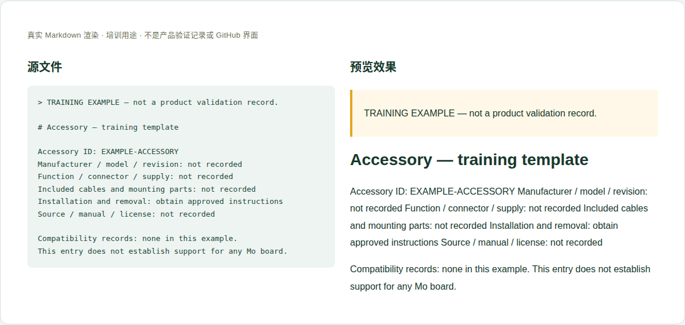

# 11 · 共用配件资料与安装指南

[培训首页](../README.zh-CN.md) · [网页操作步骤](../github-workflow.zh-CN.md)

## 维护目标与当前位置

让用户识别准确配件、阅读安装与使用限制，而不是靠营销名称猜测适配。

**实际源位置：** `accessories/catalog/；新独立配件可规划 accessories/<稳定ID>/`

**当前状态：** 当前为目录和Coming soon指引，没有已发布的完整配件清单。共用配件只保留一个权威记录，板卡适配另维护关系。

本章处理资料事实与内容。所有修改都在主题分支中完成，PR/预览/合并步骤见[网页全流程](../github-workflow.zh-CN.md)。

## 每次需要填写或核对的字段

| 字段 | 填写方法与判断依据 |
|---|---|
| 稳定ID/名称 | 目录使用稳定ID，显示名称可改，不能因此改旧链接。 |
| 厂家/型号/修订 | 准确料号、版本、来源；同名不同硬件分别区分。 |
| 功能/接口/电气 | 供电、电压、连接器和信号需求有来源。 |
| 包装与安装 | 包含哪些线缆/螺丝/转换件，安装方向与断电步骤。 |
| 尺寸和空间 | 机械包络、散热/天线/线缆限制，引用实际资料。 |
| 软件与驱动 | 需要哪些软件版本/配置，链接到mo-docs或上游。 |
| 资料与许可 | 厂商页、说明书、图片和附件公开范围。 |
| 可用性与购买 | 官方稳定产品链接；不写本站价格或未经确认生命周期承诺。 |
| 板卡关系 | 列出兼容关系记录链接，不把配件描述本身当通过证明。 |

这些字段是人工维护要求，不是已实现的Excel自动校验。填写“未记录/未测试”时同时说明缺少什么证据；不要把缺失字段改成0或默认通过。

## 网页上如何修改这一类资料

1. 先搜索是否已有相同配件记录，避免每个产品复制一份。
2. 准备型号/修订、来源、接口和安装说明，新建稳定ID资料目录。
3. 上传批准附件，安装图标明方向、电气连接和限制。
4. 请维护者把记录加入catalog与导航，随后按兼容章节建立板卡关系。
5. 发布前检查厂家链接、说明书版本及安装步骤，不把未测候选放成已支持。

完成后按统一流程保存英文提交标题，例如 `docs(hardware): update the reference details`。PR写明准确文件、来源、版本、实际检查和未完成项；新增页面/附件时明确请求映射处理。

## 可照着理解的填写示例

以下为教学样例。含 `EXAMPLE` / `not recorded` 的字段不是产品结论，须用已确认资料替换才可用于真实记录。引用已有公开记录的说明不代表本轮重做了硬件测试。

```markdown
# Accessory — training template

Accessory ID: EXAMPLE-ACCESSORY
Manufacturer / model / revision: not recorded
Function / connector / supply: not recorded
Included cables and mounting parts: not recorded
Installation and removal: obtain approved instructions
Source / manual / license: not recorded

Compatibility records: none in this example.
This entry does not establish support for any Mo board.
```



图：上述文本的本地实际渲染，帮助识别填写后的层次和表格。它不是GitHub操作截图，也不是产品站或测试验收截图。

## 附件和网站接入

共用说明书/图片放配件目录，板卡特有接线与验证放兼容记录。不要上传未授权厂商PDF，缺授权时用官方链接。

新增源文件在GitHub可见后，请维护者确认网站映射、页面引用和导航。当前构建不会自动扫描所有资料目录生成页面。你不需要编辑 `site/` 或生成目录；交接时提供目标页面和摆放位置即可。

## 提交前逐项检查

- [ ] 能凭型号和修订买到/识别同一配件。
- [ ] 安装步骤、供电和方向明确。
- [ ] 没有重复多个产品版本的同一配件正文。
- [ ] 兼容资格与证据分类明确，不承诺未证实生命周期。
- [ ] PR差异只包含本次主题，截图/附件没有内部信息，正文与下载均在对应构建中检查。
- [ ] 已准确区分真实验证、历史记录、设计参考和训练样例。

## 常见错误与正确处理

- 只写USB Wi-Fi adapter而无具体型号。
- 把官方销售、测试通过和社区反馈混成同一等级。
- 配件有对应插头就写全部Mo板卡支持。

发现上述问题时先恢复可追溯的原标识，补充来源/范围，再提交修正；不能仅删除限制文字让页面看起来完整。

## Catalog 的三个入口怎么维护

| 文件 | 维护内容 | 与单个配件记录的关系 |
|---|---|---|
| `catalog/index.en-US.md` | 栏目说明、概览和指南入口 | 只导航，不重复参数 |
| `catalog/overview.en-US.md` | 配件分类、证据等级和可用清单 | 每个条目链接唯一配件记录；未建立清单时保持准确状态 |
| `catalog/guides.en-US.md` | 安装/使用指南索引 | 链接完整指南，说明适用配件型号和版本 |

首次增加配件时，请软件维护者确定其独立页面和稳定ID；硬件工程师提供正文、附件和catalog摆放建议。日后改配件名称只改显示文字，不因此删除旧ID或在每种板卡目录重新复制指南。

## 需要交给谁处理

硬件负责型号、电气/机械和安装；软件确认驱动基线；产品负责人确认供应信息；维护者登记catalog与站点映射。

如果无法取得本章必需事实，在PR标明待确认项；可以先完成有证据的部分，不把未确认字段填成确定结论。涉及新的发布版本，由Admin按统一发布流程操作。
