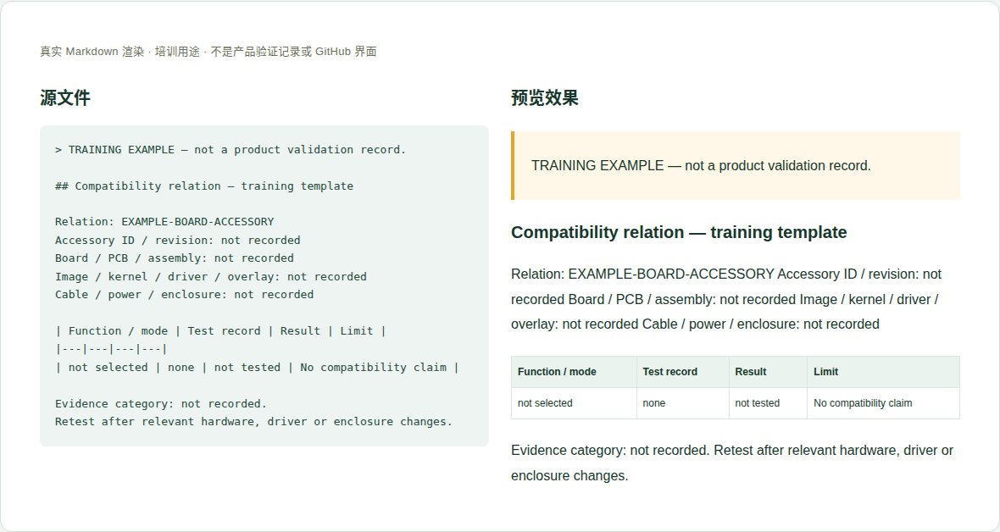

# 12 · 板卡与配件的兼容关系

[培训首页](../README.zh-CN.md) · [网页操作步骤](../github-workflow.zh-CN.md)

## 维护目标与当前位置

回答“这个具体配件能否在这块板、这个装配/软件版本、这些条件下使用”，并保留失败和限制。

**实际源位置：** `accessories/compatibility/mo62a/：supported-accessories.en-US.md、hat-compatibility.en-US.md`

**当前状态：** 当前为占位，没有可作为任意HAT或外设已通过证明的完整记录。需要从单个配件和明确测试条件建立关系。

本章处理资料事实与内容。所有修改都在主题分支中完成，PR/预览/合并步骤见[网页全流程](../github-workflow.zh-CN.md)。

## 每次需要填写或核对的字段

| 字段 | 填写方法与判断依据 |
|---|---|
| 关系ID/配件ID | 引用共用配件唯一记录，不复制整个配件说明。 |
| 板卡与装配 | 产品、PCB/BOM版本、内存/外壳等相关选项。 |
| 配件修订与线缆 | 型号、硬件修订、转换线或适配板准确身份。 |
| 软件基线 | 镜像、内核、驱动、设备树/boot配置。 |
| 电气/机械条件 | 针脚、电压、供电预算、间距/高度、散热和冲突。 |
| 功能与用例 | 具体测试的功能、速率、负载、时长和次数。 |
| 结果与证据 | 通过/失败/部分通过/未测；链接原始测试记录。 |
| 限制与未覆盖 | 不支持的模式、必须的操作、未测试的组合。 |
| 来源分类与复测 | 自测/第三方报告/社区反馈，日期及何种变更需要复测。 |

这些字段是人工维护要求，不是已实现的Excel自动校验。填写“未记录/未测试”时同时说明缺少什么证据；不要把缺失字段改成0或默认通过。

## 网页上如何修改这一类资料

1. 先确认配件共用记录，收集准确型号与硬件修订。
2. 写出板卡/软件组合和待验证功能，检查电气和机械前提。
3. 关联接口/功耗/机械等已有或新测试记录，逐功能记录结果。
4. 更新supported-accessories或hat-compatibility，并链接配件指南和证据。
5. 板卡/配件/镜像变化后检查是否仍在范围；必要时标待复测而非自动沿用通过。

完成后按统一流程保存英文提交标题，例如 `docs(hardware): update the reference details`。PR写明准确文件、来源、版本、实际检查和未完成项；新增页面/附件时明确请求映射处理。

## 可照着理解的填写示例

以下为教学样例。含 `EXAMPLE` / `not recorded` 的字段不是产品结论，须用已确认资料替换才可用于真实记录。引用已有公开记录的说明不代表本轮重做了硬件测试。

```markdown
## Compatibility relation — training template

Relation: EXAMPLE-BOARD-ACCESSORY
Accessory ID / revision: not recorded
Board / PCB / assembly: not recorded
Image / kernel / driver / overlay: not recorded
Cable / power / enclosure: not recorded

| Function / mode | Test record | Result | Limit |
|---|---|---|---|
| not selected | none | not tested | No compatibility claim |

Evidence category: not recorded.
Retest after relevant hardware, driver or enclosure changes.
```



图：上述文本的本地实际渲染，帮助识别填写后的层次和表格。它不是GitHub操作截图，也不是产品站或测试验收截图。

## 附件和网站接入

关系记录中保留板卡特有接线和测试数据；共用图片/手册引用配件记录。不要复制一套通用测试结果到所有型号。

新增源文件在GitHub可见后，请维护者确认网站映射、页面引用和导航。当前构建不会自动扫描所有资料目录生成页面。你不需要编辑 `site/` 或生成目录；交接时提供目标页面和摆放位置即可。

## 提交前逐项检查

- [ ] 关系两端的产品/配件/修订都能唯一定位。
- [ ] 结论只覆盖实际测试功能和版本组合。
- [ ] 失败和限制没有在汇总表中消失。
- [ ] 每个“支持”可追溯到记录与日期。
- [ ] PR差异只包含本次主题，截图/附件没有内部信息，正文与下载均在对应构建中检查。
- [ ] 已准确区分真实验证、历史记录、设计参考和训练样例。

## 常见错误与正确处理

- 一个版本通过，默认所有硬件/镜像版本通过。
- 一条社区反馈改写为InHand认证。
- 40针机械可插入就写电气兼容。

发现上述问题时先恢复可追溯的原标识，补充来源/范围，再提交修正；不能仅删除限制文字让页面看起来完整。

## 板卡目录中的三个页面怎么维护

| 文件 | 维护重点 | 操作说明 |
|---|---|---|
| `index.en-US.md` | 当前板卡配件栏目入口 | 保留到支持清单与HAT专题的准确链接 |
| `supported-accessories.en-US.md` | 全部已建立记录的配件关系 | 汇总型号、配件修订、板卡/软件范围、结果、限制及证据入口 |
| `hat-compatibility.en-US.md` | 40针扩展专题 | 除上述字段，逐项检查电源/逻辑电压、物理针脚、复用冲突、外形间隙和驱动 |

HAT同时出现在支持清单和专题页时，两处引用同一个关系记录；不要复制两套测试数据。删除支持状态或新增限制时，两处摘要一起更新，保留历史证据和受影响版本。

## 需要交给谁处理

硬件/软件共同确认组合与边界；你维护关系表和证据链接；管理员只在检查和资料审阅完成后合并，不用权限替代验证。

如果无法取得本章必需事实，在PR标明待确认项；可以先完成有证据的部分，不把未确认字段填成确定结论。涉及新的发布版本，由Admin按统一发布流程操作。
