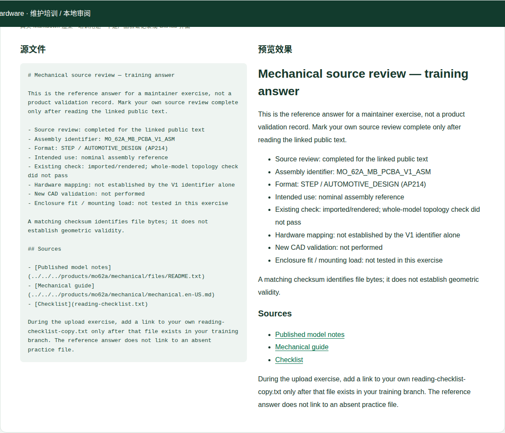

# 完整练习：维护一份机械资料审阅说明

[培训首页](../../README.zh-CN.md) · [GitHub 网页流程](../../github-workflow.zh-CN.md) · [机械资料专项](../../categories/06-mechanical.zh-CN.md)

本练习只维护训练文件，不改变产品规格、不上传新CAD模型、不创建发布Tag。练习目标是完成一次“正文修改 + 附件 + 差异检查 + Draft PR + CI + 反馈”的工作流。练习中的产品文件事实来自现有公开机械说明；它不构成一次新的CAD、装配或电气验证。

## 练习输入与交付物

| 文件 | 用途 |
|---|---|
| [record.en-US.md](record.en-US.md) | 待修改的练习记录；初始状态为未完成来源阅读 |
| [reading-checklist.txt](reading-checklist.txt) | 已提供的无敏感信息附件，用于下载与上传练习 |
| [solution.en-US.md](solution.en-US.md) | 完成后的参考文本，先做练习再对照 |
| 本页的PR说明范例 | 练习如何描述证据、范围与结果 |

每个学员使用自己的主题分支 `training/<英文标识>-mechanical-review`。为减少同时培训冲突，建议在自己的Fork进行；也可在讲师分配的上游临时分支操作。Draft PR明确标注Training only，讲师检查后关闭，不合入产品内容。

## 第一步：确认现有公开资料

1. 在新的浏览器标签打开 [机械说明](../../../products/mo62a/mechanical/mechanical.en-US.md)。
2. 打开 [模型来源README](../../../products/mo62a/mechanical/files/README.txt)。
3. 在README中找到装配标识、格式、用途、既有导入检查、拓扑检查结果和适用范围限制。
4. 不需要下载153.9MiB STEP，也不需要安装CAD；本练习只核对文档。

你应找到：`MO_62A_MB_PCBA_V1_ASM`、`AUTOMOTIVE_DESIGN (AP214)`、名义装配参考、可以导入/渲染但整模型拓扑检查未通过，以及未验证壳体配合/载荷等范围。它们来自已有记录，不是你刚刚测得的结果。

## 第二步：建分支并改正文

按照[网页流程第2–6步](../../github-workflow.zh-CN.md#2-从最新-master-创建工作分支)建分支，打开本目录 `record.en-US.md`，点铅笔。

完成以下**准确改动**：

| 初始字段 | 改成什么 | 为什么 |
|---|---|---|
| `Source review: not completed` | `Source review: completed for the linked public text` | 表明仅完成来源文字核对 |
| `Assembly identifier: not recorded` | `Assembly identifier: MO_62A_MB_PCBA_V1_ASM` | 按公开README原文抄写 |
| `Format: not recorded` | `Format: STEP / AUTOMOTIVE_DESIGN (AP214)` | 保留格式/协议标识 |
| `Intended use: not recorded` | `Intended use: nominal assembly reference` | 没有扩成制造放行 |
| `Existing check: not recorded` | `Existing check: imported/rendered; whole-model topology check did not pass` | 不能只写“打开成功” |

保留 `Training only`、`New CAD validation: not performed`、装配对应关系与壳体测试边界。若你未完成文字核对，不能直接照答案标 completed。

切换 Preview 后检查表格/列表和链接；保存标题使用：

```text
docs(training): record the mechanical source review
```

## 第三步：练习上传和引用附件

1. 打开本目录的 `reading-checklist.txt`，点击 **Raw** / 下载原始文件，保存为 `reading-checklist-copy.txt`。这只是字节相同的练习副本，不修改产品模型。
2. 在自己的分支进入同一目录，**Add file → Upload files** 上传这个副本。
3. 用 `docs(training): add the review checklist copy` 保存。
4. 回到 `record.en-US.md`，在 Checklist 链接下增加：

```markdown
- [Uploaded checklist copy](reading-checklist-copy.txt)
```

5. 用 `docs(training): link the uploaded checklist` 保存。点击链接确认能打开文件。

真实项目中不要为同一个附件到处制造副本；此处为了练习上传只在训练分支进行，关闭PR后不保留到master。训练文件未加入产品站的assets映射，所以不会出现在产品网站；这是预期行为。

## 第四步：查看差异并创建Draft PR

确认差异只包含本练习记录和新附件，未修改产品目录、源码、规则或Release。创建PR时 base 是 `inhandnet/mo-hardware:master`（Fork时通过跨仓库比较），compare 是自己的训练分支。

标题：

```text
docs(training): practice a mechanical record update
```

正文范例：

```markdown
## Summary

Training only; do not merge as product documentation.

完成机械资料文字审阅练习，修改record并上传/链接练习附件。
来源是仓库现有机械说明和模型README。
没有重新执行CAD检查，也没有新增装配/壳体测试。

## Validation

- 已逐项核对装配标识、格式、用途和原有检查限制。
- 已在GitHub Preview检查格式，并打开附件链接。
- Files changed仅含训练文件。
- commit-message / ci：等待运行，完成后补真实结果。
```

选择 **Create draft pull request**。不要写不存在的PR号或假装CI已经通过。

## 第五步：检查CI与处理一次反馈

查看 `commit-message` 和 `ci`。通过后把实际run链接和结果补入PR说明。产品站构建应保持原产品内容；训练文件在仓库中审阅，不需要申请产品站路由。

讲师提出一条反馈，例如“补充文件hash只证明字节一致、不证明几何有效”。你在同一分支的记录中补一句：

```markdown
A matching checksum identifies file bytes; it does not establish geometric validity.
```

保存合规标题，确认原PR自动更新并重新检查。回到评论回复具体改动位置。讲师可对照 [solution.en-US.md](solution.en-US.md)，检查你是否仍保留所有限制。



图：训练答案的本地渲染，仅演示预期文字效果，不表示任何真实PR或产品发布成功。

## 第六步：关闭练习并迁移到实际任务

讲师验收后 **Close pull request**，删除本次训练分支。不要点击Squash and merge、创建Tag或替换真实STEP文件。你自己Fork中的训练文件也可随分支一起删除，不影响上游。

实际机械资料更新沿用同样流程，但文件位置改为 `products/mo62a/mechanical/`，每个字段由实际批准来源填写。新增下载需维护者登记assets并检查站点下载；Ready for review之后由Admin合并，需要发布时另建新Tag。不要把练习中的未记录字段直接复制到已确认规格上。

## 讲师验收

- [ ] 学员能指出工作分支与master的区别。
- [ ] 五个字段与公开来源一致，旧拓扑限制仍在。
- [ ] 上传附件可打开，记录中的相对链接有效。
- [ ] PR标题和每个提交标题符合英文规范。
- [ ] PR清楚说明来源核对、新验证未执行及培训范围。
- [ ] 学员能找到两个必需检查和实际日志。
- [ ] 反馈在同一分支处理，PR自动更新。
- [ ] 学员能说明训练文件不会自动进入产品站。
- [ ] 练习关闭，未合入产品内容、未创建Tag。

未完成的项记录实际原因；不要用本手册截图替代学员自己的操作结果。
