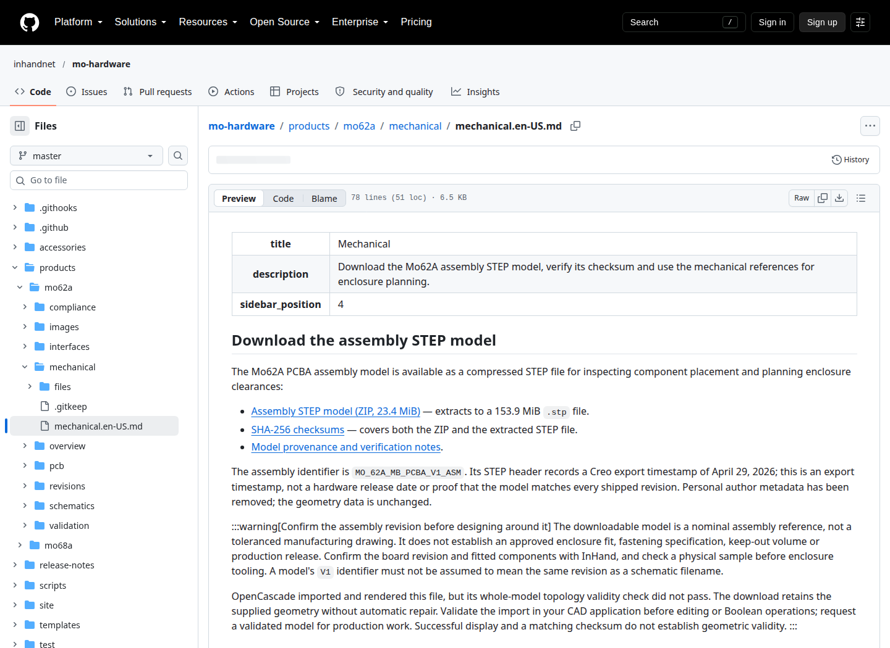
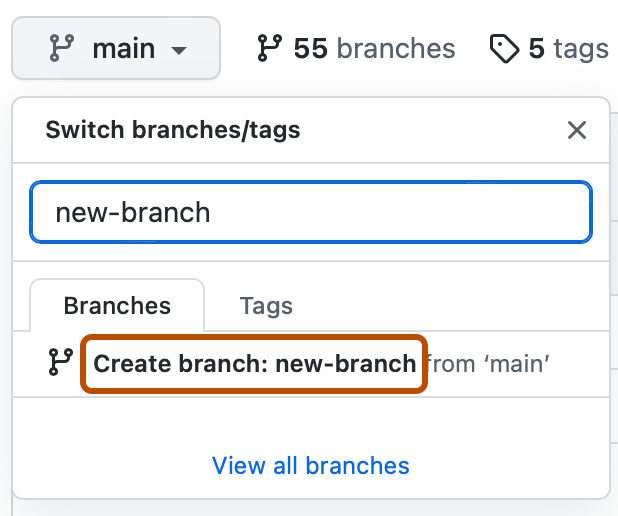
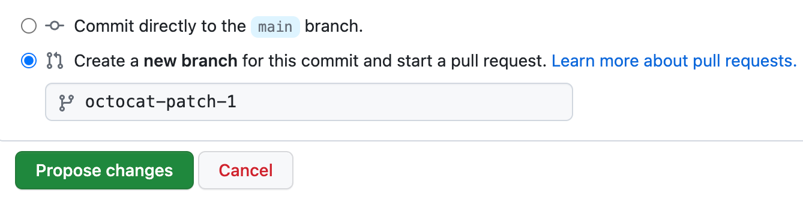
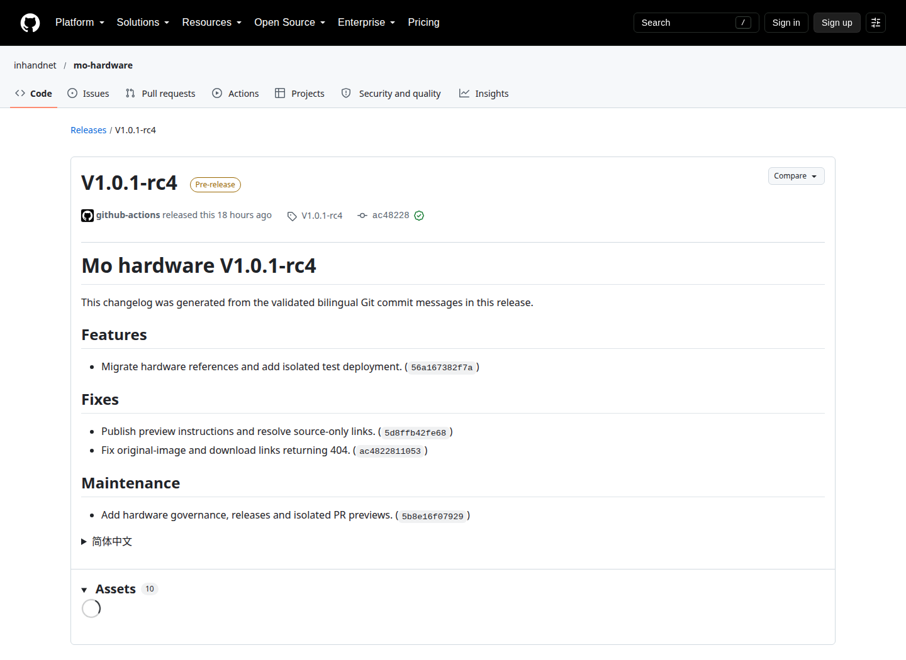

# 在 GitHub 网页维护 mo-hardware：从修改到发布

[返回培训首页](README.zh-CN.md)

本流程以“给机械资料补充可追溯的文件说明”为例。先在[练习目录](examples/mechanical-review/README.zh-CN.md)操作一次，再将同样方法用于有真实来源的产品资料。浏览器按钮可能随 GitHub 更新略有变化；以按钮名称、目标仓库和当前分支为准。

## 0. 准备资料与账号

准备 GitHub 账号、已确认可公开的正文/附件、板卡/装配版本与来源。不要把账号密码、内网地址、个人序列号、客户信息和未公开设计放到截图或 PR。此仓库公开，工作分支和 Draft PR 也不是保密空间。

打开 [inhandnet/mo-hardware](https://github.com/inhandnet/mo-hardware)。右上角完成 GitHub 登录。若你不能创建临时分支，向管理员确认 Write 权限；只读账号可使用 Fork。不要为了编辑申请 Admin。

先明确本次是：修改已有页、增加资料附件、增加新页面，还是培训练习。已有页通常只改源文件；新增内容需要维护者处理映射。培训分支只演练，不把虚构数据合入产品页。

## 1. 找到源文件

在仓库的 **Code** 标签页，逐级打开：

`products` → `mo62a` → `mechanical` → `mechanical.en-US.md`

也可以按键盘 `t` 搜索文件名，或使用 [机械页源文件直达链接](https://github.com/inhandnet/mo-hardware/blob/master/products/mo62a/mechanical/mechanical.en-US.md)。核对面包屑路径，避免改到 `site/.generated/` 或其他产品。



图：真实公开源文件页面。正文里的 `/img/` 和 `/downloads/` 是网站路径，因此 GitHub 预览中图片不显示不一定代表网站损坏；后面必须再做完整站点预览。

## 2. 从最新 master 创建工作分支

回到 Code 页面，点击文件列表上方的分支下拉框，先选择 **master**。再次展开，输入一个新分支名，例如：

```text
docs/mo62a-mechanical-reference-note
```

培训时使用 `training/<你的英文标识>-mechanical-review`，避免与同事的分支重名。点击 **Create branch: … from master**。如果使用 Branches 页面上的 **New branch**，同样选择 source branch `master`。




图：GitHub 官方示意，图中的 `main` / `new-branch` 等名称只是示例。此仓库基线是 `master`，新分支填写上面的主题名。创建后必须在左上角看到自己的分支名称，再开始编辑。

**预期结果：** 你的分支已有 master 的文件，可以独立保存修改；master 没有变化。

**没有创建权限时：** 点击仓库右上 **Fork**，在自己的 Fork 中从 master 创建分支，完成修改后通过 **Contribute → Open pull request** 提回 `inhandnet/mo-hardware:master`。若 Fork 已存在，先点 **Sync fork** 更新；发生冲突时请维护者协助，不直接覆盖文件。

## 3. 打开编辑器

在自己的分支中打开目标 `.md` 文件，点击右上角铅笔 **Edit this file**。不要点删除文件，也不要在 master 上直接保存。


编辑器中的顶部元信息通常类似：

```yaml
---
title: "Mechanical"
description: "Download and inspect the board reference files."
sidebar_position: 4
---
```

这是页面标题、摘要和导航顺序。修改普通正文时保留这两条 `---` 和已有字段；不要自行添加 `slug`、改动标题层级或删除页面 ID。页面地址由映射维护。

## 4. 修改正文：按来源写，而不是按印象写

找到具体段落，作最小且完整的修改。说明“什么变了、来自哪里、适用谁、仍不知道什么”。例如，文件使用说明可补充：

```markdown
### Keep the exact reference with your project

Record the downloaded archive filename, hardware-site Release tag and
SHA-256 in your project notes. A matching hash identifies the file bytes;
it does not establish enclosure fit or correspondence to every assembly.
```

此段只是维护操作示例，不代表你已经获得某块板卡的装配对应关系。实际产品改动必须由资料来源支撑。正文自然段建议保持单行，编辑器可自动显示换行；不要为了网页宽度手动把每句话切成短行。

常用 Markdown：

| 目的 | 输入方式 | 检查 |
|---|---|---|
| 二级标题 | `## Reference files` | 保留原标题/锚点，改名需检查旧链接 |
| 列表 | `- Confirm the assembly revision.` | 每条一个动作 |
| 粗体 | `**Reference only**` | 只强调关键用途或边界 |
| 网页链接 | `[Mechanical](/mo-62a/hardware-development/mechanical/)` | 使用已存在的网址 |
| 图片 | `` | 路径需已登记；说明观察方向 |
| 表格 | 用 `|` 分列，第二行写 `|---|---|` | 单元格中的 `|` 需转义为 `\|` |

需要插入程序或命令时使用三反引号代码块，标明语言。不要把未经验证的接线/写寄存器命令当说明性文本提交。

## 5. 使用 Preview 检查文字

切换编辑器上方 **Preview**，检查标题、列表、表格、代码块和特殊字符。发现格式错误就返回 **Edit** 修改。


**此处应检查：** 表格没有变成一长段、代码块正确结束、链接文字可读、数值与单位完整。Docusaurus 的 `:::info` 提示框、站点绝对路径图片和下载在 GitHub 预览可能不完整，后续查看完整网站。不要为了让 GitHub 显示图片而把已正确的网站路径改坏。

## 6. 保存到当前工作分支

点击 **Commit changes…**。在提交标题输入英文 Conventional Commit，例如：

```text
docs(mechanical): clarify reference model usage
```

标题最多 72 字符，不以句号结尾；`docs` 表示资料变化，`mechanical` 表示范围。GitHub 默认的 `Update ...` 往往不符合规则，需要改写。正文可以留空，或简短说明依据和验证；不再填写双语 `Message:` 块，不加 `Co-Authored-By`，不写 `[skip ci]`。

如果你已在主题分支，选择 **Commit directly to the … branch**，并确认显示的就是主题分支。这里“directly”允许保存到工作分支，不能选 master。若编辑时尚未建分支，选择 **Create a new branch for this commit and start a pull request**，填写新分支名。



图：官方示例展示尚未建分支时的选项。已建分支时继续保存到同一主题分支，不为每个文件再建一个分支。

保存后核对分支名称、提交标题和刚修改的文件。网页保存不会运行本地 Git hook，规则由提交后的 PR CI 再检查。

## 7. 上传附件：选对目录和分支

仍在同一工作分支，进入资料的 `files/` 或 `images/` 目录。点击 **Add file → Upload files**，将文件拖入上传区域，或点 **choose your files**。


文件按类别放置，例如：

| 文件 | 推荐位置 |
|---|---|
| 原理图 PDF | `products/mo62a/schematics/files/` |
| 机械 STEP ZIP / 尺寸图 | `products/mo62a/mechanical/files/` |
| 共用产品/接口图片 | `products/mo62a/images/` |
| 某次测试原始 CSV / 仪器说明 | 对应 `validation/.../<记录ID>/files/` |
| 共用配件附件 | `accessories/<配件稳定ID>/files/`（新结构需维护者确认映射） |

GitHub 网页单文件上传上限为 25 MiB；本仓库检查上限为 50 MiB。超过网页上限但不超过仓库上限时，请软件维护者通过本地 Git 提交；超过仓库上限需另行安排版本化下载。不要改扩展名绕过限制，也不要提交 Git LFS 指针。已有 STEP ZIP 约 23.4 MiB，不代表以后任何 STEP 都能网页上传。

上传前确认文件是最终导出版本，能在 PDF/CAD/图片查看器中打开；去掉不应公开的个人或客户信息。保留第三方许可与来源。提交标题例：`docs(mechanical): add the reference note attachment`。保存到同一主题分支。

要新建目录，可以从 **Add file → Create new file** 在文件名中输入 `new-record/description.en-US.md`；保存后目录形成，再进入目录上传。不要为了建空目录上传无用二进制文件。

## 8. 附件说明、哈希与网站映射

正文记录文件名、资料版本、板卡/装配适用范围、来源、用途和未验证项。对于下载文件，维护者计算 SHA-256；你可以在 PR 中明确请求计算，不手填看似正确的哈希。需要自己核算时，Windows PowerShell 使用 `Get-FileHash -Algorithm SHA256 <文件>`，macOS 使用 `shasum -a 256 <文件>`，Linux 使用 `sha256sum <文件>`。

已有映射文件只改内容时，通常原 URL 保持不变。新增附件或重命名文件时，PR 中写明：

```text
Source: products/mo62a/mechanical/files/<actual-file-name>
Intended page: /mo-62a/hardware-development/mechanical/
Placement: download list, after the existing model notes
Please register the website asset URL and verify its download hash.
```

软件维护者更新 `site/content-map.json` 的 `assets`，确认 `source` 指向仓库真实文件、`target` 是站点路径，并在正文添加已确认的链接。新增页面还需 `routes`、页面元信息和侧栏。硬件贡献者不需要直接编辑 JSON。

**不要忽略：** 仓库中看得到附件，不等于网站中下载得到；`manifest.json` 中有文件，不等于页面或链接已经接入。

## 9. 创建 Pull request

返回仓库首页，使用 **Compare & pull request**；也可进入 **Pull requests → New pull request**。确认：

- base repository：`inhandnet/mo-hardware`
- base：`master`
- compare：你的主题分支（Fork 时为你的账号和分支）


输入合规标题，例如 `docs(mechanical): clarify reference model usage`。PR 正文按照模板写清范围、来源、适用版本、验证结果及未完成工作。可以用中文详细说明；squash 后正文会进入提交消息，普通长行适当折到 72 字符以内，URL 行例外。

```markdown
## Summary

补充机械参考文件的保存与追溯说明。
适用：本次引用的具体装配资料；不增加生产尺寸或装配兼容承诺。

## Validation

- 已核对源文件、版本、来源和公开范围。
- 已在 GitHub Preview 检查正文格式。
- 新附件需要维护者登记网站映射并复核 SHA-256。
- 完整站点预览和 CI：待运行，完成后补结果。
```

培训用 Draft PR，标题例如 `docs(training): practice a mechanical record update`，正文首行写“Training only; do not merge as product documentation.”。实际工作准备好后才设为 **Ready for review**。

## 10. 查看 Files changed

进入 PR 的 **Files changed** 标签。红色表示删除，绿色表示新增；逐文件确认没有误改其他产品、删除来源/限制、覆盖旧文件或加入内部资料。


新 PDF/ZIP 无法像文字一样逐行比较，需要重新下载并用对应查看器检查。图片查看朝向、比例、标签；不要把看起来相同当作字节相同。培训练习应只出现练习文件，不能有真实产品规格变化。

## 11. 查看必需 CI

回到 PR 的 **Conversation** 或 **Checks**，展开检查列表。必需检查名为：

| 检查 | 检查什么 | 失败时先看什么 |
|---|---|---|
| `commit-message` | PR 标题、新提交的英文规范，禁止跳过 CI 等 | 日志中的提交 SHA 与错误提示 |
| `ci` | Shell/YAML、内容/路径、测试、类型、构建、浏览器和下载 | 第一个失败步骤，区分正文问题与工具问题 |

黄色表示运行中，红色表示失败，绿色才是完成。点击对应检查的 **Details** 查看日志。不要截图一段“build succeeded”就认为整个任务成功；看作业最终状态。

PR 标题错可用 **Edit** 改标题并保存，`commit-message` 会重跑。某个已保存提交的标题错时，后面加一个正确提交并不会修复旧提交；请软件维护者帮助重写主题分支历史，或从 master 建新分支重新提交正确改动。不要让硬件工程师试图强推 master 或加 skip CI。

即使两个检查都绿，也需要人工核对硬件事实、版本、接线和证据；自动化没有替你做电气测试或认证。

## 12. 查看对应的完整站点预览

CI 成功后 Pages 工作流部署完整网站。入口为 [mo-hardware Pages](https://inhandnet.github.io/mo-hardware/)。先找到对应 PR 的 Actions run，再核对预览横幅中的 PR/提交和 [deployment.json](https://inhandnet.github.io/mo-hardware/deployment.json)。

Pages 是共享槽位：另一个 PR 或 master 成功后可能覆盖当前预览。PR 构建通常使用 GitHub 的临时合并提交，其 SHA 可不同于 PR 分支 head；应与 CI run 的实际构建 SHA 比较。无法确认对应关系时，向软件维护者索取该 run 的 `hardware-site-preview` artifact 预览，不使用别人的站点作为本次验收。

逐项检查：打开目标页；看标题、表格、图片、侧栏；窄屏查看是否可读；点开每个新下载；下载文件并核对名称/大小/哈希；检查原有链接和锚点仍有效。搜索使用构建后的 Pages 网站测试。普通 GitHub Preview 不覆盖这些检查。

## 13. 按反馈修改

审阅者可能在某行评论。阅读上下文，回到**同一主题分支**修改对应源文件并保存合规提交；该 PR 会自动更新并重新跑检查。不必为每条反馈开新 PR。

在评论中说明改了哪里、证据在哪、还有什么未完成。不要只点击 Resolve conversation 而不改问题。出现 merge conflict 或 **Update branch** 时，先请维护者检查；更新后重新核对差异与 CI，不能沿用旧截图作为新版本验收。

## 14. 管理员合并

实际工作达到验收条件后，由 Admin 使用 **Squash and merge**。再次确认合并提交标题满足英文规范，正文没有模板占位内容或内部信息。必需 CI 不可跳过，也不可直接推 master。

合并后检查 PR 显示 **Merged**；源分支按仓库设置自动删除。贡献者不要在已删除分支继续写；下一任务从最新 master 建新分支。培训 PR 通常 **Close pull request** 并删除自己的训练分支，不合入产品文档。

## 15. 区分合并、预览和版本发布

合并后的 master CI 成功会更新 Pages。测试产品站 `https://developer.inhand.online/hardware-docs/` 只在管理员创建新发布 Tag 后部署，因此 master 的新内容可能暂时不在测试产品站。



图：已有历史 Release 的真实截图，用于识别版本与 Assets 入口；不表示当前练习或本轮修改已发布。

需要发版时，提交者交付：合并 PR 链接、适用硬件/资料版本、验收记录、需要验证的目标页。Admin 按 [CONTRIBUTING.md](../CONTRIBUTING.md#releases) 创建 annotated Tag 并跟踪 `release`、发布和部署作业。**不要在网页创建一个普通 Tag 充当正式流程，不改写旧 Tag。**

部署完成后确认 Release 标题/版本、在线 `deployment.json` 的版本与提交、页面内容以及下载文件。GitHub Release 成功但部署失败时，报告为“发布物已生成、测试站部署失败”，不能写成已全部上线。正式平台尚未接入。

## 16. 常见问题处理

| 现象 | 原因与操作 |
|---|---|
| 找不到铅笔或不能保存 | 先登录；确认 Write 或进入自己的 Fork |
| 无法创建分支 | 先核对权限和当前仓库；由 Admin 查看规则，不申请绕过 master CI |
| CI 说提交标题不合法 | PR 标题直接修改；历史提交由维护者协助处理 |
| 文档标题/表格显示异常 | 检查 front matter 的 `---`、引号、表格分隔行和未结束代码块 |
| GitHub 中图片不显示 | 可能是站点绝对路径；在完整网站验证，不盲改路径 |
| 仓库有附件但网站没有 | 确认 assets 映射和页面引用是否同时加入 |
| Pages 看到别人的改动 | 共享预览被覆盖；核对 CI run 与在线标记 |
| test site 还是旧版 | master 合并和 RC Tag 部署分开，查看发布作业 |
| 页面说“Coming soon” | 证据/正文尚未接入，不能仅删除提示就宣称验证完成 |
| 上传太大或只剩短文本 | 确认完整文件与大小；请维护者处理本地上传或版本化托管 |
| 门禁绿了但资料来源不清楚 | 补来源与适用范围，不能用 CI 代替事实确认 |

## 17. 可选：本地编辑

需要批量文件或大于网页上限的附件时可由软件维护者协助：克隆仓库、`git switch master`、`git pull --ff-only`、`git switch -c <主题分支>`，然后用文本编辑器修改。已有未提交工作先保存并确认归属，不能直接覆盖或清理。

安装 Node.js 22 后 `npm ci` 会安装本仓库钩子。新增文件先 `git add <明确路径>`，执行 README 的测试与构建，再 `git commit -m 'docs(scope): describe the change'` 和 `git push -u origin <主题分支>`，之后网页 PR 流程不变。此附录是可选路线，网页维护培训不要求执行这些命令。

## 18. 日常交付记录

每次任务保留：源文件路径、PR、合并提交、资料/硬件/软件适用版本、来源与公开范围、实际验证结果、未完成项，以及发布 Tag/在线验收（若本次有发布）。这些信息填写在 PR 或相应资料记录中，不需要把私有工程管理材料上传公开仓库。
